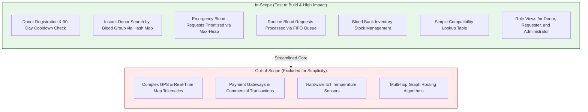

# Document 01: Project Scope & Simplified Requirements

> **System Name:** BloodLink — DS-Based Blood Donor & Emergency Management System  
> **Course / Context:** Data Structures Core Coursework  
> **Target:** A lightweight, highly achievable, and robust system built around core Data Structures for fast Data Storing, Fetching, and Retrieving.

---

## 1. Executive Summary & Problem Statement

In emergency situations, hospital staff and patients struggle to locate compatible blood units and voluntary donors in a matter of minutes. Traditional database systems often scan tables sequentially, causing delays and failing to prioritize critical trauma patients over routine elective surgeries.

**BloodLink** provides a lightweight, easy-to-build solution centered around **three core Data Structures**:
1. **Custom Hash Map ($O(1)$):** Stores donors and stock for instantaneous key-value retrieval by blood group and ID.
2. **Priority Queue / Max-Heap ($O(\log N)$):** Sorts emergency blood requisitions so the most critical patient is always served first.
3. **Standard FIFO Queue ($O(1)$):** Handles routine, non-emergency requests in fair first-come, first-served order.

---

## 2. Finalized Project Scope

### 2.1 In-Scope Capabilities
* **Donor Management:** Registration, viewing profile, 90-day cooldown validation, and one-click availability toggle.
* **Instant Donor Lookup ($O(1)$):** Requesters search compatible donors by blood group in constant time using a custom Hash Map.
* **Emergency Prioritization ($O(\log N)$):** Emergency requisitions are scored (`CRITICAL` = 300, `URGENT` = 200, `ROUTINE` = 100 + wait time) and ranked inside a Binary Max-Heap.
* **Routine Processing ($O(1)$):** Non-critical requisitions are served fairly via a FIFO Queue.
* **Stock & Donation Logging:** Blood banks add new donations and decrement stock upon request fulfillment.
* **Data Storing, Fetching & Retrieving:** Dual-layer pipeline ensuring persistent storage in MySQL and instant algorithmic access in memory.

### 2.2 Out-of-Scope (Deliberately Excluded to Save Development Time)
* Complex graph algorithms (Dijkstra) or live road traffic APIs.
* Commercial payments or monetized blood exchange.
* Physical IoT refrigerator sensor telemetry.

---

## 3. Functional Requirements (FR)

| Req ID | Module | Functional Description | DS Operation |
| :--- | :--- | :--- | :--- |
| **FR-01** | Donor Registration | Store donor with name, blood group, contact, city, age, weight. | Hash Map `put()` ($O(1)$) |
| **FR-02** | Donor Search | Retrieve available donors by blood group instantly. | Hash Map `get()` ($O(1)$) |
| **FR-03** | Cooldown Verification | Check if donor has completed 90 days since their last donation date. | Date comparison ($O(1)$) |
| **FR-04** | Emergency Requisition | Submit critical blood request and rank it in the priority queue. | Max-Heap `insert()` ($O(\log N)$) |
| **FR-05** | Routine Requisition | Submit routine blood request in standard first-come, first-served queue. | FIFO Queue `enqueue()` ($O(1)$) |
| **FR-06** | Next Emergency Extraction | Admin retrieves the highest priority emergency request. | Max-Heap `extractMax()` ($O(\log N)$) |
| **FR-07** | Stock Tracking | Fetch and update available blood units count per blood group. | Hash Map `get()` / `put()` ($O(1)$) |
| **FR-08** | Request Fulfillment | Admin matches request with stock, decrements inventory, and marks fulfilled. | Status update & stock decrement |
| **FR-09** | Compatibility Check | Validate whether donor blood group is compatible with recipient blood group. | Dictionary lookup ($O(1)$) |

---

## 4. Non-Functional Requirements (NFR)

* **Simplicity & Speed of Development:** Clean, straightforward JavaScript classes that can be implemented and tested in a few hours.
* **Sub-Millisecond Read Latency:** In-memory donor searches and stock checks resolve in $< 1\text{ ms}$.
* **Data Durability:** Every creation and status change is persisted in MySQL while remaining in-sync with memory structures.
* **Clear Codebase:** Easy-to-read code with zero over-engineering or convoluted dependencies.
