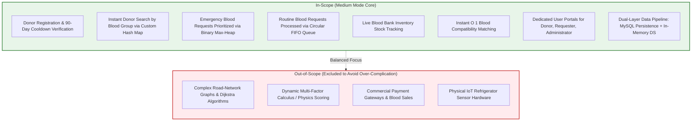

# Document 01: Project Scope & Requirements Specification

> **System Name:** BloodLink — DS-Based Blood Donor & Emergency Management System  
> **Architecture Level:** 🟡 **Medium Mode (Recommended / Balanced Academic Baseline)**  
> **Course / Context:** Data Structures Core Coursework  
> **Design Philosophy:** Real, custom Data Structures with genuine algorithmic value, zero unnecessary over-complication, and rapid full-stack feasibility.

---

## 1. Executive Summary & Problem Statement

In life-threatening medical emergencies (e.g., severe road trauma, emergency C-sections, acute surgical hemorrhage), patient survival depends on obtaining compatible blood units within minutes. Traditional blood bank systems suffer from three critical architectural flaws:

1. **Slow Linear Database Searches ($O(N)$):** Searching donors via SQL `SELECT` queries across thousands of records causes latency spikes.
2. **First-Come, First-Served (FCFS) Failures:** Routine elective transfusions (e.g., planned minor surgeries) block life-threatening accident victims waiting for the same blood type.
3. **Inventory Blindness:** Blood banks lack real-time in-memory tracking of available units by blood group.

### The Medium Mode Solution
**BloodLink (Medium Mode)** solves these issues by deploying an in-memory **Data Structures Engine** alongside persistent MySQL storage:
* **Custom Separate-Chaining Hash Map:** Delivers instant $O(1)$ donor lookups by ID and blood group, and maintains live stock counts.
* **Binary Max-Heap Priority Queue:** Prioritizes critical emergency requests in $O(\log N)$ time based on urgency severity and waiting time.
* **Circular FIFO Queue:** Guarantees fair, starvation-free processing for routine non-emergency requests in $O(1)$ time.
* **Compatibility Dictionary:** Instant $O(1)$ verification of ABO and Rh factor donor-recipient compatibility.

---

## 2. Finalized Project Scope (Medium Mode)

### 2.1 In-Scope Deliverables
1. **Donor Lifecycle & Cooldown Gate:** Register donors with age ($18\text{--}65$), weight ($\ge 45\text{ kg}$), and automatic 90-day cooldown enforcement from their last donation date.
2. **Custom Hash Map Engine:** Custom implementation of separate chaining with buckets for:
   - `donorMap`: $O(1)$ lookup by `donorId`.
   - `bloodGroupMap`: $O(1)$ retrieval of all donors matching a specific blood group.
   - `stockMap`: $O(1)$ lookup and modification of available units per group.
3. **Emergency Priority Queue Engine:** Array-based Binary Max-Heap prioritizing critical patients in $O(\log N)$ extraction time.
4. **Routine Queue Engine:** Array-based Circular FIFO Queue for routine demands ($O(1)$ enqueue/dequeue).
5. **Medical Compatibility Engine:** $O(1)$ donor-to-patient compatibility check.
6. **Data Storing, Fetching & Retrieving:** Dual-layer architecture combining persistent MySQL tables with in-memory DS caching and startup hydration.
7. **User Portals:** Specialized workflows for Donors, Requesters, and Administrators.

### 2.2 Out-of-Scope (Excluded by Design)
* **Graph Algorithms / Dijkstra:** Inter-facility road distances are not dynamically calculated via weighted graphs; facilities are chosen via clean dropdown selections.
* **Commercial Monetary Transactions:** Voluntary donation is non-remunerated under medical law; no payment gateway is implemented.
* **Hardware Telemetry:** IoT sensors for temperature monitoring are out of scope.

---

## 3. Functional Requirements (FR)

| Req ID | Module | Functional Description | DS Operation |
| :--- | :--- | :--- | :--- |
| **FR-01** | Donor Registration | Store donor with name, blood group, contact, city, age, weight. | Hash Map `put()` ($O(1)$ avg) |
| **FR-02** | Donor Search | Instantly retrieve all active donors of a given blood group. | Hash Map `get()` ($O(1)$ avg) |
| **FR-03** | Cooldown Verification | Validate whether $\ge 90\text{ days}$ have passed since last donation. | Date comparison ($O(1)$) |
| **FR-04** | Emergency Requisition | Submit critical blood request and rank it in the priority queue. | Max-Heap `insert()` ($O(\log N)$) |
| **FR-05** | Routine Requisition | Submit routine blood request into standard first-come, first-served queue. | Circular Queue `enqueue()` ($O(1)$) |
| **FR-06** | Next Emergency Extraction | Admin retrieves the highest priority emergency request. | Max-Heap `extractMax()` ($O(\log N)$) |
| **FR-07** | Stock Tracking | Fetch and update blood units count per blood group. | Hash Map `get()` / `put()` ($O(1)$) |
| **FR-08** | Request Fulfillment | Admin matches request with stock, decrements inventory, and marks fulfilled. | Status update & stock decrement |
| **FR-09** | Compatibility Validation | Validate compatibility between donor blood group and patient blood group. | Dictionary lookup ($O(1)$) |

---

## 4. Non-Functional Requirements (NFR)

* **Algorithmic Correctness:** Custom Data Structures must implement genuine pointer/array math without relying on built-in wrapper shortcuts (e.g. `Array.sort()` is banned for the Priority Queue).
* **Speed of Development:** Clean, modular JavaScript classes that can be coded, unit-tested, and integrated in under 4 hours.
* **Sub-Millisecond Read Latency:** In-memory donor searches and stock checks execute in $< 1\text{ ms}$.
* **Data Durability:** Every creation and status change is persisted in MySQL while remaining synchronized with in-memory Data Structures.

---

## 5. Teacher Viva Defense Strategy (Medium Mode)

When explaining this architecture to your instructor, highlight these exact points:
1. **Why In-Memory Data Structures over pure SQL?**
   > *"Sir, standard relational databases perform disk I/O and $O(N)$ index scans. In an emergency triage scenario with thousands of donors, our in-memory Custom Hash Map provides $O(1)$ donor retrieval, while our Binary Max-Heap guarantees that the most critical patient is extracted in $O(\log N)$ time."*
2. **Why two separate queues (Max-Heap + FIFO)?**
   > *"If we used only a FIFO queue, an accident victim could die waiting behind routine elective surgeries. If we used only a Priority Queue, routine patients might suffer starvation. We separate the streams: critical cases use a Max-Heap, while routine cases use a fair FIFO queue."*
3. **Why Separate Chaining for the Hash Map?**
   > *"Separate chaining handles collisions gracefully using bucket arrays, avoiding the clustering degradation associated with open-address linear probing."*
