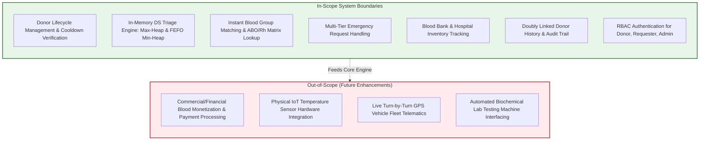

# Document 01: Project Scope & Requirements Specification

> **System Name:** BloodLink — DS-Based Blood Donor & Emergency Management System  
> **Course / Context:** Data Structures & Algorithms Core Assignment  
> **Document Status:** Finalized (Stage 01 Baseline)

---

## 1. Executive Summary & Problem Statement

Blood supply logistics and emergency transfusion requests are time-critical medical operations where delays directly impact human mortality. Traditional hospital and blood bank systems frequently encounter catastrophic bottlenecks due to:

1. **Slow Donor Search Latency:** Linear scanning ($O(N)$) of donor databases leads to delayed outreach during acute trauma and obstetric hemorrhages.
2. **First-Come, First-Served (FCFS) Pitfalls:** Standard database queuing treats life-threatening requests (e.g., severe accident victims, ICU surgeries) with the same priority as routine elective transfusions.
3. **Perishable Inventory Wastage:** Blood components possess strict, short shelf-lives (Platelets: 5 days; Red Blood Cells: 35–42 days). Without First-Expiring, First-Out (FEFO) prioritization, valuable units expire on storage shelves.
4. **Donor Fatigue & Cooldown Violations:** Lack of strict tracking leads to repeated donor contact before their mandatory 90-day recovery window.

**BloodLink** solves these systemic problems by putting **Data Structures at the core of the system architecture**. Instead of relying purely on disk-bound database queries for real-time decisions, BloodLink leverages an in-memory Data Structure Engine to provide:
- **Instantaneous ($O(1)$) Donor & Inventory Retrieval** via custom Separate-Chaining Hash Maps.
- **Strict Emergency Triage Scheduling ($O(\log N)$)** via a Binary Max-Heap Priority Queue.
- **Zero-Wastage Shelf-Life Management ($O(\log K)$)** via a Binary Min-Heap Priority Queue.
- **Fair Routine Processing ($O(1)$)** via FIFO Queues.

---

## 2. Project Scope Boundaries

### 2.1 In-Scope Deliverables
* **Donor Registry & Health Rules Engine:** Real-time validation of age ($\ge 18, \le 65$), minimum weight ($\ge 45\text{ kg}$), and automatic enforcement of the mandatory 90-day donation cooldown period.
* **Emergency Request Prioritization Engine:** An algorithmic scoring function combining medical urgency severity, wait time elapsed, required volume deficit, and geographical distance into an in-memory Max-Heap.
* **Compatibility Verification:** Algorithmic verification between 8 ABO/Rh blood groups using constant-time $O(1)$ bitmask matrix lookups.
* **Blood Bank Inventory Management:** Component tracking using a First-Expiring, First-Out (FEFO) Min-Heap to automatically dispatch older safe units first.
* **Donation History Audit Ledger:** Maintaining individual donor historical records in a Doubly Linked List for rapid bi-directional traversal and medical auditing.
* **Inter-Hospital & Blood Bank Network Routing:** Modeling medical facilities as a Weighted Graph to compute shortest paths for emergency blood bag transfers.
* **User Roles & Authorization:** Segregated access controls and specialized operational dashboards for Donors, Requesters, and Administrators.

### 2.2 Out-of-Scope (Boundaries for Assignment 1)
* **Commercial Financial Transactions:** Under national and international blood donation statutes, voluntary blood donation cannot be commercialized; thus, no payment gateways or billing modules are included.
* **Hardware IoT Sensor Telemetry:** Real-time physical refrigerator temperature readings are simulated through entity status attributes rather than live IoT hardware protocols.
* **Live GPS Navigation:** Vehicle routing is determined through graph shortest-path algorithms over distance/time weights rather than live satellite tracking integrations.

---

## 3. High-Level System Objectives

1. **Algorithmic Predictability:** Achieve predictable sub-millisecond execution times for search, insertion, and priority extraction regardless of dataset scale.
2. **Zero Blood Starvation:** Balance urgent emergency preemption with fair background servicing of routine requests to prevent starvation of non-critical patients.
3. **Traceability & Integrity:** Guarantee tamper-proof tracking of every blood unit from collection through screening to transfusion.
4. **Resilient Data Decoupling:** Decouple the persistent storage layer (MySQL) from the real-time operational layer (In-Memory Data Structure Engine).

---

## 4. Functional Requirements (FR)

| Req ID | Module | Functional Description | DS Mapping |
| :--- | :--- | :--- | :--- |
| **FR-01** | Donor Registry | Register donor with KYC, contact, address, blood group, medical vitals, and last donation timestamp. | Hash Map ($O(1)$) |
| **FR-02** | Eligibility Gate | Automatically compute donor eligibility (age, weight, 90-day cooldown) upon request dispatch. | Hash Map + Node Attribute Check ($O(1)$) |
| **FR-03** | Blood Request Creation | Requesters submit blood requirements with urgency tags, unit volume, patient condition, and target hospital. | Max-Heap / FIFO Queue |
| **FR-04** | Dynamic Triage Scoring | Calculate composite emergency priority score based on medical severity level and waiting time. | Mathematical Evaluation Function |
| **FR-05** | Emergency Dispatch | Pop highest-urgency request and allocate compatible units from nearest blood bank. | Max-Heap `extractMax()` ($O(\log N)$) |
| **FR-06** | FEFO Stock Allocation | Blood banks dispatch the safe unit with the closest expiration date to eliminate wastage. | Min-Heap `extractMin()` ($O(\log K)$) |
| **FR-07** | Donor History Log | Record chronological donation logs per donor with bidirectional navigation. | Doubly Linked List ($O(1)$ push) |
| **FR-08** | Inter-Facility Routing | Find shortest path between recipient hospital and candidate blood banks with required blood stock. | Graph Dijkstra / BFS ($O(V^2)$ or $O(E + V \log V)$) |
| **FR-09** | Compatibility Validation | Validate compatibility between donor blood group and patient blood group. | 8x8 Boolean Compatibility Matrix ($O(1)$) |
| **FR-10** | Admin Inventory Control | View inventory counts, trigger stock alerts, and inspect priority request heap. | Hash Map Aggregation + Heap Inspection |

---

## 5. Non-Functional Requirements (NFR)

* **Performance & Latency:**
  * Donor search lookup: $< 2\text{ ms}$ (utilizing in-memory Hash Table).
  * Emergency priority queue extraction: $< 5\text{ ms}$ ($O(\log N)$ binary heap operations).
  * Compatibility verification: $< 0.1\text{ ms}$ (matrix table lookup).
* **Reliability & Consistency:**
  * Atomicity in blood unit reservation: A single blood unit can never be allocated to two concurrent requests (mutual exclusion on inventory nodes).
* **Data Integrity & Auditability:**
  * Immutability of past donation records in the donor's history chain.
* **Scalability:**
  * System must support an active pool of $100,000+$ registered donors and $10,000+$ concurrent blood requests without degradation in heap extraction speed.
