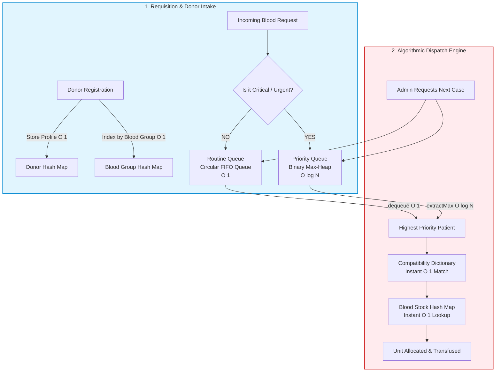
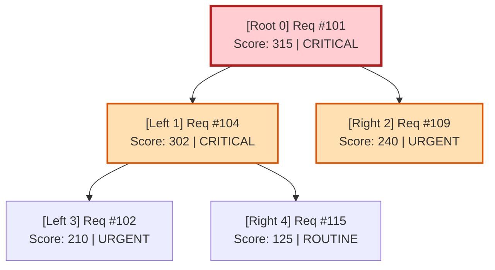

# Document 02: Data Structures Flow & Algorithmic Architecture

> **Architecture Level:** 🟡 **Medium Mode (Recommended / Balanced Academic Baseline)**  
> **Core Focus:** Three Custom In-Memory Data Structures (Separate-Chaining Hash Map, Binary Max-Heap, Circular Queue) + Compatibility Lookup Dictionary.  
> **Academic Rigor:** Full algorithmic integrity, verifiable time/space complexities, and zero reliance on high-level array shortcuts like `Array.sort()`.

---

## 1. Medium Mode Data Structure Ecosystem



---

## 2. In-Depth Data Structure Specifications & Contracts

### 2.1 Custom Hash Map (Separate Chaining with Buckets)

#### Purpose & Use Cases:
1. **`donorMap` (Key: `donorId` $\to$ Value: `Donor Object`):** Instant profile retrieval.
2. **`bloodGroupMap` (Key: `"O+"`, `"A-"` $\to$ Value: `[donorId1, donorId2, ...]`):** Fast donor matching without scanning non-matching records.
3. **`stockMap` (Key: `bloodGroup` $\to$ Value: `unitCount`):** Live in-memory inventory count.

#### Technical Implementation Details:
* **Storage Model:** An array of $M$ buckets (default $M = 37$, a prime number to reduce collisions).
* **Collision Resolution:** **Separate Chaining** — each bucket contains an array of `{ key, value }` entries.
* **Hash Function:** Polynomial rolling hash for strings:
  $$\text{hash}(s) = \left( \sum_{i=0}^{k-1} s[i] \cdot 31^{k-1-i} \right) \pmod M$$

#### JavaScript Blueprint / Class Contract:
```javascript
class CustomHashMap {
  constructor(capacity = 37) {
    this.capacity = capacity;
    this.buckets = new Array(capacity).fill(null).map(() => []);
    this.size = 0;
  }

  // Polynomial rolling hash function
  _hash(key) {
    let hashVal = 0;
    const strKey = String(key);
    for (let i = 0; i < strKey.length; i++) {
      hashVal = (hashVal * 31 + strKey.charCodeAt(i)) % this.capacity;
    }
    return hashVal;
  }

  // Storing: O(1) average time
  put(key, value) {
    const idx = this._hash(key);
    const bucket = this.buckets[idx];
    const existing = bucket.find((entry) => entry.key === key);
    if (existing) {
      existing.value = value;
    } else {
      bucket.push({ key, value });
      this.size++;
    }
  }

  // Fetching / Retrieving: O(1) average time
  get(key) {
    const idx = this._hash(key);
    const entry = this.buckets[idx].find((entry) => entry.key === key);
    return entry ? entry.value : null;
  }

  // Check existence: O(1) average time
  has(key) {
    return this.get(key) !== null;
  }
}
```

---

### 2.2 Priority Queue (Binary Max-Heap)

#### Purpose:
Ensures life-threatening emergency requests (e.g. trauma hemorrhage) jump to the head of the dispatch queue immediately, rather than waiting behind routine elective requests.

#### Priority Scoring Logic:
Every emergency request receives a dynamic score computed as:
$$\text{PriorityScore} = \text{Base Urgency Score} + \text{Minutes Waiting}$$

* `CRITICAL`: **300 points** (Trauma, shock, active surgical hemorrhage)
* `URGENT`: **200 points** (Emergency C-section, scheduled critical surgery)
* `ROUTINE`: **100 points** (Elective reserve)
* *Aging factor:* $+1\text{ point per minute elapsed}$ prevents earlier urgent cases from being permanently starved by newly arriving critical cases.

#### Heap Memory Representation (Array-Based):
Stored as a flat contiguous array where for any element at index $i$:
* **Parent:** $\lfloor(i - 1) / 2\rfloor$
* **Left Child:** $2i + 1$
* **Right Child:** $2i + 2$



#### JavaScript Blueprint / Class Contract:
```javascript
class PriorityQueueMaxHeap {
  constructor() {
    this.heap = [];
  }

  // Helper index calculations
  _parent(i) { return Math.floor((i - 1) / 2); }
  _leftChild(i) { return 2 * i + 1; }
  _rightChild(i) { return 2 * i + 2; }
  _swap(i, j) {
    const temp = this.heap[i];
    this.heap[i] = this.heap[j];
    this.heap[j] = temp;
  }

  // Storing: O(log N)
  insert(request) {
    this.heap.push(request);
    this._heapifyUp(this.heap.length - 1);
  }

  _heapifyUp(i) {
    while (i > 0 && this.heap[i].priorityScore > this.heap[this._parent(i)].priorityScore) {
      this._swap(i, this._parent(i));
      i = this._parent(i);
    }
  }

  // Retrieving: O(log N)
  extractMax() {
    if (this.heap.length === 0) return null;
    if (this.heap.length === 1) return this.heap.pop();

    const max = this.heap[0];
    this.heap[0] = this.heap.pop();
    this._heapifyDown(0);
    return max;
  }

  _heapifyDown(i) {
    let largest = i;
    const left = this._leftChild(i);
    const right = this._rightChild(i);
    const n = this.heap.length;

    if (left < n && this.heap[left].priorityScore > this.heap[largest].priorityScore) {
      largest = left;
    }
    if (right < n && this.heap[right].priorityScore > this.heap[largest].priorityScore) {
      largest = right;
    }

    if (largest !== i) {
      this._swap(i, largest);
      this._heapifyDown(largest);
    }
  }

  // Inspecting top without removal: O(1)
  peek() {
    return this.heap.length > 0 ? this.heap[0] : null;
  }

  size() {
    return this.heap.length;
  }
}
```

---

### 2.3 Circular FIFO Queue (Routine Requests)

#### Purpose:
Provides strict First-In, First-Out (FIFO) processing for routine, non-emergency blood requests. Ensures zero starvation and absolute scheduling fairness.

#### Technical Implementation Details:
* **Storage Model:** Contiguous array with fixed capacity $C = 100$ and wrapping indices:
  * `front`: Pointer to the first element to dequeue.
  * `rear`: Pointer to the next insertion slot.
  * `count`: Tracks the current number of elements.
* **Wrap-around Formula:** `rear = (rear + 1) % capacity`.

#### JavaScript Blueprint / Class Contract:
```javascript
class CircularFIFOQueue {
  constructor(capacity = 100) {
    this.capacity = capacity;
    this.queue = new Array(capacity);
    this.front = 0;
    this.rear = 0;
    this.count = 0;
  }

  // Storing: O(1)
  enqueue(item) {
    if (this.isFull()) throw new Error("Routine Queue is full");
    this.queue[this.rear] = item;
    this.rear = (this.rear + 1) % this.capacity;
    this.count++;
  }

  // Retrieving: O(1)
  dequeue() {
    if (this.isEmpty()) return null;
    const item = this.queue[this.front];
    this.queue[this.front] = null;
    this.front = (this.front + 1) % this.capacity;
    this.count--;
    return item;
  }

  peek() {
    return this.isEmpty() ? null : this.queue[this.front];
  }

  isEmpty() { return this.count === 0; }
  isFull() { return this.count === this.capacity; }
  size() { return this.count; }
}
```

---

### 2.4 Blood Compatibility Dictionary

A constant-time lookup dictionary modeling standard biological ABO and Rh erythrocyte compatibility:

```javascript
const BLOOD_COMPATIBILITY = {
  'O-':  ['O-'],
  'O+':  ['O-', 'O+'],
  'A-':  ['O-', 'A-'],
  'A+':  ['O-', 'O+', 'A-', 'A+'],
  'B-':  ['O-', 'B-'],
  'B+':  ['O-', 'O+', 'B-', 'B+'],
  'AB-': ['O-', 'A-', 'B-', 'AB-'],
  'AB+': ['O-', 'O+', 'A-', 'A+', 'B-', 'B+', 'AB-', 'AB+']
};

// O(1) Compatibility check function
function isCompatible(donorGroup, recipientGroup) {
  const safeDonors = BLOOD_COMPATIBILITY[recipientGroup];
  return safeDonors ? safeDonors.includes(donorGroup) : false;
}
```

---

## 3. Algorithmic Complexity Profile

| Data Structure | Operations | Time Complexity (Best) | Time Complexity (Average) | Time Complexity (Worst) | Space Complexity |
| :--- | :--- | :---: | :---: | :---: | :---: |
| **Custom Hash Map** | `put()`, `get()`, `has()` | $O(1)$ | $O(1)$ | $O(N)$ (extreme collision) | $O(N + M)$ |
| **Binary Max-Heap** | `insert()`, `extractMax()` | $O(1)$ | $O(\log N)$ | $O(\log N)$ | $O(N)$ |
| **Binary Max-Heap** | `peek()` | $O(1)$ | $O(1)$ | $O(1)$ | $O(1)$ |
| **Circular FIFO Queue** | `enqueue()`, `dequeue()` | $O(1)$ | $O(1)$ | $O(1)$ | $O(C)$ |
| **Compatibility Table** | `isCompatible()` | $O(1)$ | $O(1)$ | $O(1)$ | $O(1)$ ($8 \text{ entries}$) |

---

## 4. Teacher Viva Q&A Guide (Medium Mode)

Be prepared to answer these classic viva questions:

* **Q1: Why did you choose Separate Chaining over Linear Probing for your Hash Map?**
  > *Answer:* Separate Chaining handles collisions without clustering. In open-address linear probing, collisions cause "primary clustering," which rapidly degrades performance to $O(N)$. With separate chaining, each bucket maintains a small independent list, maintaining near-$O(1)$ lookup times.
* **Q2: Why use an array for the Binary Max-Heap instead of a pointer-based binary tree?**
  > *Answer:* An array representation eliminates the memory overhead of storing `left`, `right`, and `parent` object pointers. More importantly, array elements reside in contiguous memory, maximizing CPU cache locality and allowing parent/child lookups using fast integer arithmetic ($2i+1, 2i+2$).
* **Q3: What prevents non-emergency patients from waiting forever in the Priority Queue?**
  > *Answer:* Two mechanisms: First, we add an aging bonus ($+1\text{ point per minute}$) to older requests so their priority naturally climbs over time. Second, routine elective requests are routed to a separate, dedicated FIFO queue that guarantees first-come, first-served fairness.
* **Q4: Why does a Circular Queue use modulo arithmetic `(rear + 1) % capacity`?**
  > *Answer:* In a standard array queue, dequeuing elements leaves empty spaces at the front that cannot be reused without expensive $O(N)$ array shifting. Modulo arithmetic wraps around to the beginning of the array, achieving reusable fixed-space capacity with $O(1)$ operations.
