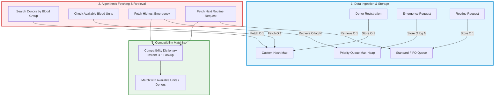
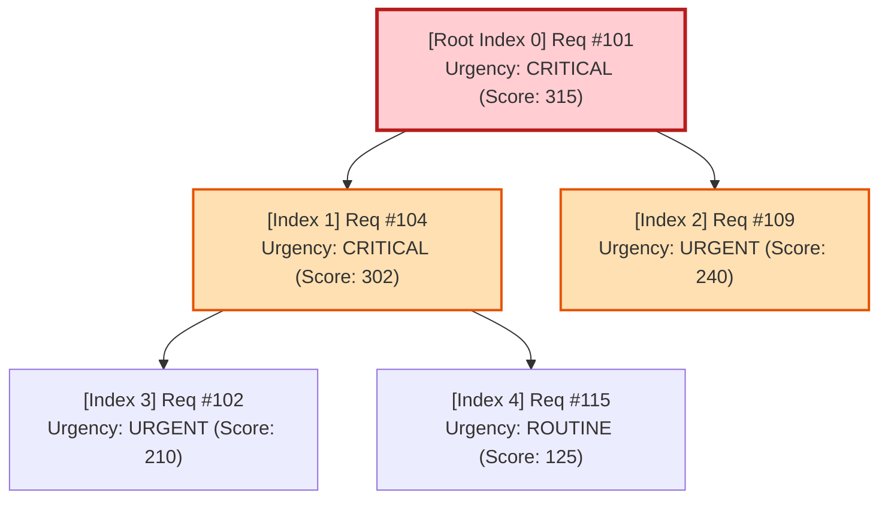

# Document 02: Data Structures Flow & Algorithmic Architecture

> **Focus:** Streamlined, Easy-to-Build In-Memory Data Structures for Fast Data Storing, Fetching, and Retrieving.  
> **Core Rule:** Maintain high algorithmic value (Hash Map, Priority Queue, FIFO Queue) while keeping implementation simple and rapid to code.

---

## 1. Core Data Structures Overview

To make BloodLink easy and fast to build in JavaScript/Node.js, we focus on **three primary data structures** plus a static compatibility lookup table:



---

## 2. Detailed Data Structure Designs

### 2.1 Custom Hash Map (Separate Chaining)

#### Why it's easy to build:
A custom Hash Map in JavaScript can be implemented in under 60 lines of code using an array of buckets where each bucket holds a simple array or linked list of key-value pairs `[key, value]`.

#### Primary Uses in BloodLink:
1. **`donorMap` (Key: `donorId` $\to$ Value: `donorObject`):**
   * **Storing:** `donorMap.put(donor.id, donor)` $\to$ $O(1)$ average.
   * **Fetching / Retrieving:** `donorMap.get(donorId)` $\to$ returns full profile in $O(1)$ time.
2. **`bloodGroupMap` (Key: `bloodGroup` $\to$ Value: `[donorId1, donorId2, ...]`):**
   * **Storing:** On donor registration, push donor ID into the group's array.
   * **Fetching / Retrieving:** `bloodGroupMap.get("O+")` returns all O+ donors in $O(1)$ average time.
3. **`stockMap` (Key: `bloodGroup` $\to$ Value: `unitCount`):**
   * **Storing:** Increment count when donation is added.
   * **Fetching / Retrieving:** Instant $O(1)$ check of current unit availability.

#### Simple JavaScript Implementation Contract:
```javascript
class CustomHashMap {
  constructor(capacity = 32) {
    this.buckets = new Array(capacity).fill(null).map(() => []);
    this.capacity = capacity;
    this.size = 0;
  }

  // Simple, fast polynomial hash function
  hash(key) {
    let hashVal = 0;
    const str = String(key);
    for (let i = 0; i < str.length; i++) {
      hashVal = (hashVal * 31 + str.charCodeAt(i)) % this.capacity;
    }
    return hashVal;
  }

  // Storing Data
  put(key, value) {
    const idx = this.hash(key);
    const bucket = this.buckets[idx];
    const found = bucket.find((entry) => entry.key === key);
    if (found) {
      found.value = value;
    } else {
      bucket.push({ key, value });
      this.size++;
    }
  }

  // Fetching / Retrieving Data
  get(key) {
    const idx = this.hash(key);
    const found = this.buckets[idx].find((entry) => entry.key === key);
    return found ? found.value : null;
  }
}
```

---

### 2.2 Priority Queue / Binary Max-Heap (Emergency Requisitions)

#### Why it's easy to build:
Implemented as a standard contiguous array. No complex node pointers or tree rotations are required. Child indices are simply $2i + 1$ and $2i + 2$, and parent is $\lfloor(i - 1) / 2\rfloor$.

#### Simple Priority Scoring Logic:
To make priority scoring intuitive and fast to compute, we use a simple tiered score plus minutes elapsed:
$$\text{Priority} = (\text{UrgencyBaseScore}) + (\text{MinutesWaiting})$$

* **Base Urgency Scores:**
  * `CRITICAL`: 300 points (immediate emergency, e.g., trauma/accident)
  * `URGENT`: 200 points (scheduled urgent surgery)
  * `ROUTINE`: 100 points
* **Minutes Waiting:** Adds 1 point for every minute waiting, ensuring that older urgent requests naturally rise in priority and avoid starvation.

#### Core Operations:
* **Storing Data (`insert(request)`):**
  * Appends request to the array.
  * Calls `heapifyUp()` until the heap property is satisfied.
  * **Time Complexity:** $O(\log N)$.
* **Retrieving Data (`extractMax()`):**
  * Extracts the root element (the highest priority emergency).
  * Moves the last element to root and calls `heapifyDown()`.
  * **Time Complexity:** $O(\log N)$.
* **Inspecting (`peek()`):**
  * Returns the top emergency without removing it.
  * **Time Complexity:** $O(1)$.



---

### 2.3 Standard Queue (FIFO Queue for Routine Requisitions)

#### Why it's easy to build:
A straightforward First-In, First-Out Queue manages non-critical, elective blood demands.

#### Core Operations:
* **Storing Data (`enqueue(request)`):** Inserts request at the tail ($O(1)$).
* **Retrieving Data (`dequeue()`):** Retrieves and removes request from the head in arrival order ($O(1)$).
* **Guarantees:** Strict fairness with zero priority calculations needed.

---

### 2.4 Blood Compatibility Dictionary

A simple, static JavaScript lookup dictionary that replaces complex matrix calculations:

```javascript
const BLOOD_COMPATIBILITY = {
  'O-':  ['O-'],
  'O+':  ['O-', 'O+'],
  'A-':  ['O-', 'A-'],
  'A+':  ['O-', 'O+', 'A-', 'A+'],
  'B-':  ['O-', 'B-'],
  'B+':  ['O-', 'O+', 'B-', 'B+'],
  'AB-': ['O-', 'A-', 'B-', 'AB-'],
  'AB+': ['O-', 'O+', 'A-', 'A+', 'B-', 'B+', 'AB-', 'AB+']
};

// Checking compatibility is a single line of code:
function isCompatible(donorGroup, recipientGroup) {
  return BLOOD_COMPATIBILITY[recipientGroup]?.includes(donorGroup) || false;
}
```
* **Time Complexity:** $O(1)$ instant array lookup.

---

## 3. Data Storage, Fetching & Retrieval Complexity Matrix

| Operation | Component | Data Structure | Time Complexity | Implementation Difficulty |
| :--- | :--- | :--- | :---: | :---: |
| **Store Donor Profile** | Donor Registration | Custom Hash Map | $O(1)$ avg | Very Easy (Array of buckets) |
| **Fetch Donor by Blood Group** | Donor Search | Custom Hash Map | $O(1)$ avg | Very Easy (Index key lookup) |
| **Store Emergency Request** | Requisition Ingestion | Binary Max-Heap | $O(\log N)$ | Easy (Array index math) |
| **Retrieve Top Emergency** | Triage Allocation | Binary Max-Heap | $O(\log N)$ | Easy (`extractMax`) |
| **Store Routine Request** | Standard Queue | FIFO Queue | $O(1)$ | Very Easy (`push` / `shift`) |
| **Retrieve Next Routine** | Standard Processing | FIFO Queue | $O(1)$ | Very Easy |
| **Verify Compatibility** | Validation Engine | Compatibility Map | $O(1)$ | Trivial (JS Object) |
