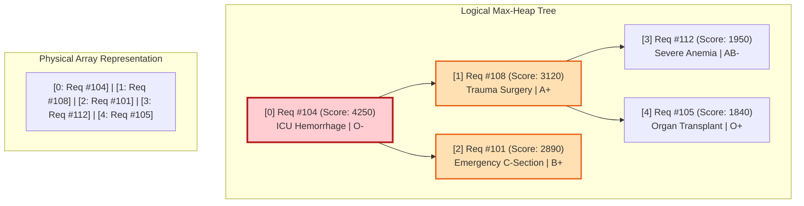
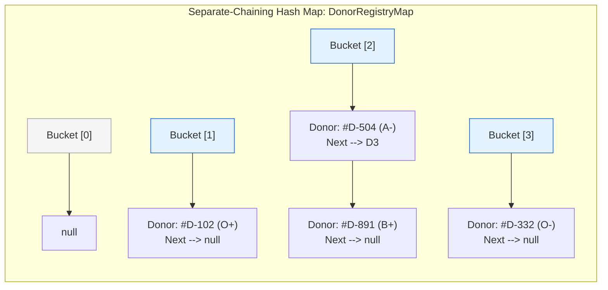
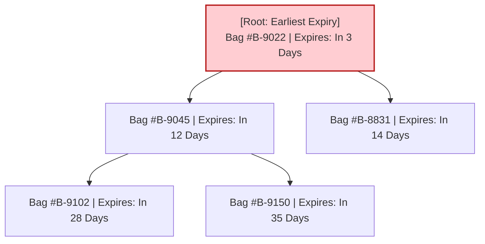
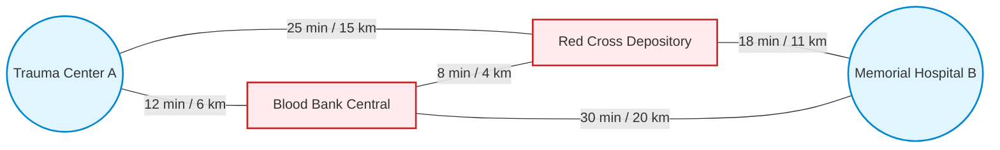

# Document 02: Data Structures Flow & Algorithmic Architecture

> **Focus:** Data Structure Engine Design, Priority Flow, and Complexity Profiling  
> **Core Principle:** In-Memory Algorithmic Efficiency for Sub-Millisecond Emergency Response

---

## 1. Architectural Philosophy: Why Data Structures First?

In a high-stakes emergency blood management environment, database I/O latency (disk seeking, query parsing, connection pooling) can introduce delays measured in hundreds of milliseconds. When multiple trauma centers request rare blood types concurrently, standard SQL queries (`ORDER BY urgency DESC, created_at ASC`) require full-table or index scans that degrade under peak load.

**BloodLink implements an in-memory Data Structure Engine** that operates directly on memory-resident algorithmic data structures. The persistent database (MySQL) serves as the persistent system of record, while the **DS Engine executes all operational logic: priority ranking, donor lookup, expiry dispatch, and transit routing**.

```mermaid
flowchart TD
    subgraph INTAKE["1. Requisition & Triage Ingestion"]
        Req[Incoming Blood Request] --> Classify{Urgency Level?}
        Classify -- Critical / Emergency --> MaxHeap["Emergency Priority Queue\n(Binary Max-Heap)"]
        Classify -- Routine / Elective --> FIFOQueue["Routine Processing Queue\n(Circular FIFO Queue)"]
    end

    subgraph ENGINE["2. Algorithmic Matching & Inventory Engine"]
        MaxHeap -->|Extract-Max O(log N)| TriageWorker[Triage Dispatch Worker]
        FIFOQueue -->|Dequeue O(1)| TriageWorker
        
        TriageWorker --> CompatCheck["ABO/Rh Compatibility\n(8x8 Constant-Time Matrix)"]
        CompatCheck --> InvLookup["Inventory Stock Lookup\n(Separate-Chaining Hash Map)"]
        
        InvLookup --> FEFO["Shelf-Life Optimization\n(Binary Min-Heap FEFO)"]
        InvLookup --> DonorSearch["Active Voluntary Donor Index\n(Hash Map by Blood Group)"]
    end

    subgraph LOGISTICS["3. Routing, Audit & History"]
        FEFO --> RouteOpt["Logistics Routing Engine\n(Weighted Graph + Dijkstra)"]
        DonorSearch --> RouteOpt
        
        RouteOpt --> Allocation[Unit Allocated / Donor Dispatched]
        Allocation --> HistUpdate["Append Donation Ledger\n(Doubly Linked List)"]
        HistUpdate --> PersistentDB[(Persistent MySQL Storage)]
    end

    style INTAKE fill:#e1f5fe,stroke:#0288d1,stroke-width:2px
    style ENGINE fill:#ffebee,stroke:#d32f2f,stroke-width:2px
    style LOGISTICS fill:#e8f5e9,stroke:#388e3c,stroke-width:2px
```

---

## 2. In-Depth Data Structure Specifications

### 2.1 Binary Max-Heap: Emergency Request Priority Queue

#### Use Case:
Handles life-threatening blood requisitions (e.g., severe hemorrhage, trauma surgery, pediatric critical care). Ensures that the most acute emergency is always serviced next, regardless of arrival order.

#### Priority Scoring Mathematical Formula:
Every blood request is assigned a dynamic priority score calculated as:
$$\text{PriorityScore}(R) = (W_u \cdot U) + (W_t \cdot \Delta t) + (W_v \cdot V) - (W_d \cdot D)$$

Where:
* $U \in \{4: \text{Immediate/Resuscitation}, 3: \text{Critical/Emergency}, 2: \text{Urgent}, 1: \text{Routine}\}$: Clinical urgency tier.
* $\Delta t$: Waiting time elapsed in minutes (prevents starvation of earlier urgent cases).
* $V$: Units required deficit weight.
* $D$: Distance in kilometers between hospital and nearest matching supply node.
* Standard default weights: $W_u = 1000$, $W_t = 15$, $W_v = 50$, $W_d = 5$.

#### Heap Structure:
Stored as a contiguous zero-indexed array where for any node at index $i$:
* **Parent:** $\lfloor(i - 1) / 2\rfloor$
* **Left Child:** $2i + 1$
* **Right Child:** $2i + 2$



#### Core Operations & Complexities:
* `insert(Request)`: Append to end of array and execute `heapifyUp()`. **Time:** $O(\log N)$, **Space:** $O(1)$.
* `extractMax()`: Swap root with last element, pop last, and execute `heapifyDown()`. **Time:** $O(\log N)$, **Space:** $O(1)$.
* `peekMax()`: Return element at index `0`. **Time:** $O(1)$, **Space:** $O(1)$.
* `increasePriority(requestId, bonus)`: Recompute score and `heapifyUp()`. **Time:** $O(\log N)$ with position index map.

---

### 2.2 Custom Hash Map: O(1) Indexing & Lookup Engine

#### Use Case:
Instant retrieval of donor profiles, blood group inventories, and medical facilities without linear list traversals.

#### Structural Design:
Implemented via **Separate Chaining with Doubly Linked Buckets**:
* **Load Factor Threshold ($\alpha$):** $0.75$.
* **Dynamic Rehashing:** When $\text{size} / \text{capacity} \ge 0.75$, capacity doubles to the next prime number to minimize collisions.
* **Hash Function:** DJB2 or Polynomial Rolling Hash:
  $$\text{hash}(s) = \left( \sum_{i=0}^{k-1} s[i] \cdot p^i \right) \pmod m \quad (p = 31, m = 2^{31}-1)$$



#### Dedicated Hash Map Instances:
1. `DonorRegistryMap`: Key = `donorId` (String), Value = Pointer to `DonorNode`.
2. `BloodGroupIndexMap`: Key = `BloodGroupId` (e.g., `"O_POS"`, `"A_NEG"`), Value = Linked list of active donor references.
3. `BloodBankInventoryMap`: Key = `bloodBankId + "_" + bloodGroupId`, Value = Pointer to `InventoryBucket` containing FEFO Min-Heap of available bags.

---

### 2.3 Binary Min-Heap: FEFO (First-Expiring, First-Out) Blood Unit Inventory

#### Use Case:
Whole blood and separated components possess short shelf-lives. Dispensing random units causes older bags to expire in storage. The FEFO Min-Heap always dispenses the unit with the **earliest expiry timestamp**.

#### Heap Key:
$$\text{Key} = \text{expiryDate.getTime()} \quad (\text{Unix Epoch in milliseconds})$$



* **Allocation Operation:** `dispenseNextUnit()` calls `extractMin()`, guaranteeing zero preventable expirations. **Time Complexity:** $O(\log K)$, where $K$ is the number of blood bags in that specific group bucket.

---

### 2.4 Circular FIFO Queue: Routine Non-Critical Requisitions

#### Use Case:
Used for routine surgical reserves, scheduled elective procedures, and walk-in camp donor queues.

#### Structural Design:
Implemented via a fixed-capacity circular array using `front`, `rear`, and `count` indices:
* `enqueue(request)`: `rear = (rear + 1) % capacity`. **Time:** $O(1)$.
* `dequeue()`: `front = (front + 1) % capacity`. **Time:** $O(1)$.
* **Advantage:** Prevents memory reallocation overhead and guarantees pure First-Come, First-Served fairness with zero starvation among routine cases.

---

### 2.5 Doubly Linked List: Donor Donation History Ledger

#### Use Case:
Every donor profile contains a bidirectional sequence of historical donation milestones, laboratory health test results, and status updates.

#### Structural Design:
```mermaid
graph LR
    subgraph DLL["Doubly Linked List (Donor Donation History)"]
        Head[Head / Most Recent] -->|next| N1[Donation: 2026-08-10\n450ml | Screened: Pass]
        N1 -->|prev| Head
        N1 -->|next| N2[Donation: 2026-04-12\n450ml | Screened: Pass]
        N2 -->|prev| N1
        N2 -->|next| N3[Donation: 2025-11-20\n350ml | Screened: Pass]
        N3 -->|prev| N2
        N3 -->|next| Tail[null]
    end
    
    style Head fill:#c8e6c9,stroke:#2e7d32
    style N1 fill:#e8f5e9,stroke:#4caf50
    style N2 fill:#e8f5e9,stroke:#4caf50
    style N3 fill:#e8f5e9,stroke:#4caf50
```

#### Core Benefits:
* **$O(1)$ Insertion:** New donation records are pushed directly to the `Head`.
* **Bi-directional Audits:** Health inspectors can audit backwards from the most recent donation or traverse forward from initial donor enrollment.
* **$O(1)$ Deletion:** If a contaminated batch is flagged, the specific node is excised in $O(1)$ time once referenced, without shifting array elements.

---

### 2.6 Weighted Graph: Logistics Network & Shortest Route Dispatch

#### Use Case:
Inter-hospital transfers and blood bank distribution routes. Blood must travel along the path with the minimum transit delay.

#### Structural Design:
* **Vertices ($V$):** Blood Banks, Regional Storage Hubs, Trauma Centers, and Hospitals.
* **Edges ($E$):** Road/transit segments weighted by physical distance (km) or estimated transit duration (minutes).
* **Algorithm:** **Dijkstra’s Algorithm** with an Indexed Min-Heap to find the shortest delivery corridor from the inventory location to the recipient hospital.
* **Time Complexity:** $O((V + E) \log V)$ using Min-Heap priority queue.



---

### 2.7 8x8 Blood Group Compatibility Matrix

#### Implementation:
Constant-time ($O(1)$) boolean compatibility check table implemented as a 2D boolean array or bitmask:

| Patient (Recipient) ↓ \ Donor → | O- | O+ | B- | B+ | A- | A+ | AB- | AB+ |
| :---: | :---: | :---: | :---: | :---: | :---: | :---: | :---: | :---: |
| **O-** | ✅ | ❌ | ❌ | ❌ | ❌ | ❌ | ❌ | ❌ |
| **O+** | ✅ | ✅ | ❌ | ❌ | ❌ | ❌ | ❌ | ❌ |
| **B-** | ✅ | ❌ | ✅ | ❌ | ❌ | ❌ | ❌ | ❌ |
| **B+** | ✅ | ✅ | ✅ | ✅ | ❌ | ❌ | ❌ | ❌ |
| **A-** | ✅ | ❌ | ❌ | ❌ | ✅ | ❌ | ❌ | ❌ |
| **A+** | ✅ | ✅ | ❌ | ❌ | ✅ | ✅ | ❌ | ❌ |
| **AB-** | ✅ | ❌ | ✅ | ❌ | ✅ | ❌ | ✅ | ❌ |
| **AB+** (Universal Recipient) | ✅ | ✅ | ✅ | ✅ | ✅ | ✅ | ✅ | ✅ |

* **Bitwise Representation:** Each blood group is encoded as an 8-bit mask. Compatibility verification executes in a single CPU cycle:
  $$\text{isCompatible}(\text{donorMask}, \text{recipientMask}) = (\text{donorMask} \ \& \ \text{recipientMask}) == \text{donorMask}$$

---

## 3. Data Structure Complexity Profiling Matrix

| Data Structure | Primary Component / Module | Access | Search | Insertion | Deletion | Space Complexity |
| :--- | :--- | :---: | :---: | :---: | :---: | :---: |
| **Binary Max-Heap** | Emergency Request Triage | $O(1)$ (peek) | $O(N)$ | $O(\log N)$ | $O(\log N)$ | $O(N)$ |
| **Binary Min-Heap** | FEFO Stock Expiration Engine | $O(1)$ (peek) | $O(K)$ | $O(\log K)$ | $O(\log K)$ | $O(K)$ |
| **Separate-Chaining Hash Map** | Donor Registry & Inventory Index | $O(1)$ avg | $O(1)$ avg | $O(1)$ avg | $O(1)$ avg | $O(N)$ |
| **Circular FIFO Queue** | Routine / Elective Requisitions | $O(1)$ | $O(N)$ | $O(1)$ | $O(1)$ | $O(C)$ (fixed cap) |
| **Doubly Linked List** | Donor Medical & Donation History | $O(N)$ | $O(N)$ | $O(1)$ (head) | $O(1)$ (with node) | $O(H)$ |
| **Adjacency List Graph** | Blood Bank & Hospital Network | $O(1)$ | $O(V + E)$ | $O(1)$ | $O(V)$ | $O(V + E)$ |
| **2D Matrix / Bitmask** | ABO & Rh Compatibility Table | $O(1)$ | $O(1)$ | $O(1)$ | N/A | $O(1)$ ($8 \times 8$) |
