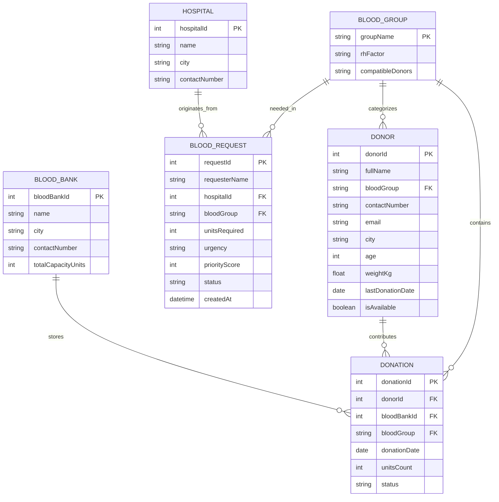
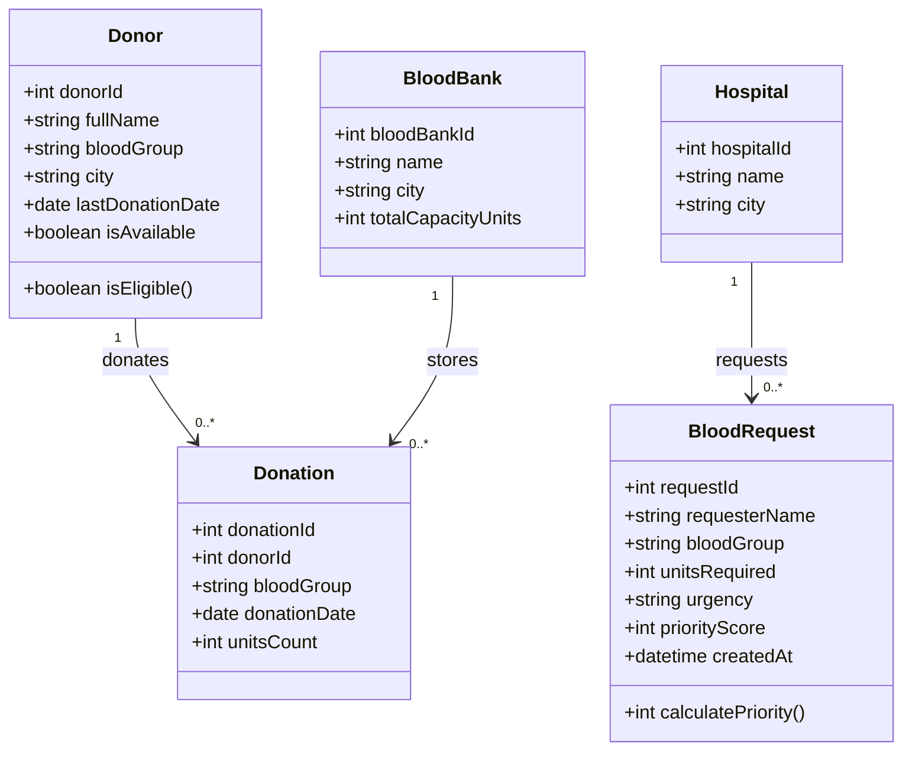

# Document 03: Core Entity Definitions & Simplified Schemas

> **Scope:** Definitive technical specifications for the six core domain entities in **BloodLink**: `Donor`, `Blood Group`, `Donation`, `Blood Bank`, `Hospital`, and `Blood Request`.  
> **Design Goal:** Clean, practical schemas that are fast to build in MySQL and simple to manipulate in JavaScript.

---

## 1. Domain Entity Relationship Diagram (ERD)

---

## 2. Practical Entity Technical Specifications

### 2.1 Entity: `Donor`
Represents an individual who registers to donate blood.

* **Validation Rules:**
  * Age: $18 \le \text{age} \le 65$.
  * Weight: $\ge 45\text{ kg}$.
  * Cooldown Check: Eligible if `lastDonationDate` is `null` OR $\ge 90\text{ days}$ prior to today.
* **Data Storage & Retrieval:**
  * **Stored in:** MySQL `donors` table + `donorMap` (Hash Map) by `donorId`.
  * **Retrieved by:** Blood group search queries `bloodGroupMap.get(group)` in $O(1)$ time.

#### Schema Table:
| Field Name | Type | Nullable | Description / Usage |
| :--- | :--- | :---: | :--- |
| `donorId` | `INT AUTO_INCREMENT` | No | Primary Key. |
| `fullName` | `VARCHAR(100)` | No | Full name of donor. |
| `bloodGroup` | `VARCHAR(5)` | No | e.g., `'O+'`, `'A-'`, `'AB+'`. Foreign Key. |
| `contactNumber`| `VARCHAR(15)` | No | Phone number for contact. |
| `email` | `VARCHAR(100)` | No | Email address. |
| `city` | `VARCHAR(50)` | No | City for regional donor filtering. |
| `age` | `INT` | No | Donor age (18–65). |
| `weightKg` | `FLOAT` | No | Donor weight (minimum 45 kg). |
| `lastDonationDate`| `DATE` | Yes | Last date blood was given (used for 90-day cooldown). |
| `isAvailable` | `BOOLEAN` | No | Toggle: `true` (Active), `false` (Unavailable). Default `true`. |

---

### 2.2 Entity: `Blood Group`
Static reference entity classifying ABO and Rh blood groups.

* **Data Storage & Retrieval:**
  * Pre-loaded table / constant catalog of the 8 standard blood groups (`A+`, `A-`, `B+`, `B-`, `AB+`, `AB-`, `O+`, `O-`).
  * Instant $O(1)$ compatibility checks via `BLOOD_COMPATIBILITY` object.

#### Schema Table:
| Field Name | Type | Nullable | Description / Usage |
| :--- | :--- | :---: | :--- |
| `groupName` | `VARCHAR(5)` | No | Primary Key (e.g., `'O+'`, `'O-'`). |
| `rhFactor` | `ENUM('+','-')` | No | Positive or Negative Rh factor. |
| `compatibleDonors` | `VARCHAR(100)` | No | Comma-separated compatible donor groups (e.g. `'O-,O+'`). |

---

### 2.3 Entity: `Donation`
Represents an individual donation event where a unit of blood is harvested and added to stock.

* **Data Storage & Retrieval:**
  * **Stored in:** MySQL `donations` table.
  * **Side Effects:** Automatically updates the donor's `lastDonationDate` to today's date and increments inventory count in `stockMap` ($O(1)$).

#### Schema Table:
| Field Name | Type | Nullable | Description / Usage |
| :--- | :--- | :---: | :--- |
| `donationId` | `INT AUTO_INCREMENT` | No | Primary Key. |
| `donorId` | `INT` | No | Foreign Key referencing `Donor`. |
| `bloodBankId` | `INT` | No | Foreign Key referencing `Blood Bank`. |
| `bloodGroup` | `VARCHAR(5)` | No | Foreign Key referencing `Blood Group`. |
| `donationDate`| `DATE` | No | Date donation occurred. |
| `unitsCount` | `INT` | No | Number of units collected (default: `1`). |
| `status` | `ENUM('SAFE','USED','DISCARDED')` | No | Status of the donated unit. Default `'SAFE'`. |

---

### 2.4 Entity: `Blood Bank`
Represents a central blood storage facility managing inventory.

* **Data Storage & Retrieval:**
  * **Stored in:** MySQL `blood_banks` table.
  * **In-Memory Tracking:** Current available stock is tracked in `stockMap` (Hash Map) for instant lookups.

#### Schema Table:
| Field Name | Type | Nullable | Description / Usage |
| :--- | :--- | :---: | :--- |
| `bloodBankId` | `INT AUTO_INCREMENT` | No | Primary Key. |
| `name` | `VARCHAR(100)` | No | Blood bank name. |
| `city` | `VARCHAR(50)` | No | City location. |
| `contactNumber`| `VARCHAR(15)` | No | Contact phone number. |
| `totalCapacityUnits`| `INT` | No | Maximum safe storage volume. |

---

### 2.5 Entity: `Hospital`
Represents a medical clinic or trauma center where patients receive blood transfusions.

* **Data Storage & Retrieval:**
  * **Stored in:** MySQL `hospitals` table. Simple drop-down selection on request forms.

#### Schema Table:
| Field Name | Type | Nullable | Description / Usage |
| :--- | :--- | :---: | :--- |
| `hospitalId` | `INT AUTO_INCREMENT` | No | Primary Key. |
| `name` | `VARCHAR(100)` | No | Hospital name. |
| `city` | `VARCHAR(50)` | No | City location. |
| `contactNumber`| `VARCHAR(15)` | No | Contact phone number. |

---

### 2.6 Entity: `Blood Request`
Represents an urgent or routine requisition for blood.

* **Data Storage & Retrieval:**
  * **Stored in:** MySQL `blood_requests` table.
  * **In-Memory Queue:**
    * If `urgency` is `'CRITICAL'` or `'URGENT'`: Stored in **Priority Queue (Max-Heap)** ($O(\log N)$).
    * If `urgency` is `'ROUTINE'`: Stored in **Standard Queue (FIFO)** ($O(1)$).
  * **Retrieved by:** Admin dashboard fetches the next emergency via `priorityQueue.extractMax()`.

#### Schema Table:
| Field Name | Type | Nullable | Description / Usage |
| :--- | :--- | :---: | :--- |
| `requestId` | `INT AUTO_INCREMENT` | No | Primary Key. |
| `requesterName`| `VARCHAR(100)` | No | Name of person requesting. |
| `hospitalId` | `INT` | No | Foreign Key referencing `Hospital`. |
| `bloodGroup` | `VARCHAR(5)` | No | Blood group needed (e.g., `'O-'`). |
| `unitsRequired`| `INT` | No | Units needed (e.g., 1 to 5 units). |
| `urgency` | `ENUM('ROUTINE','URGENT','CRITICAL')` | No | Determines queue placement. |
| `priorityScore`| `INT` | No | Priority score calculated at insertion. |
| `status` | `ENUM('PENDING','FULFILLED','CANCELLED')`| No | Current state. Default `'PENDING'`. |
| `createdAt` | `DATETIME` | No | Timestamp of creation (used as tie-breaker). |

---

## 3. Class Structure & In-Memory Representation

