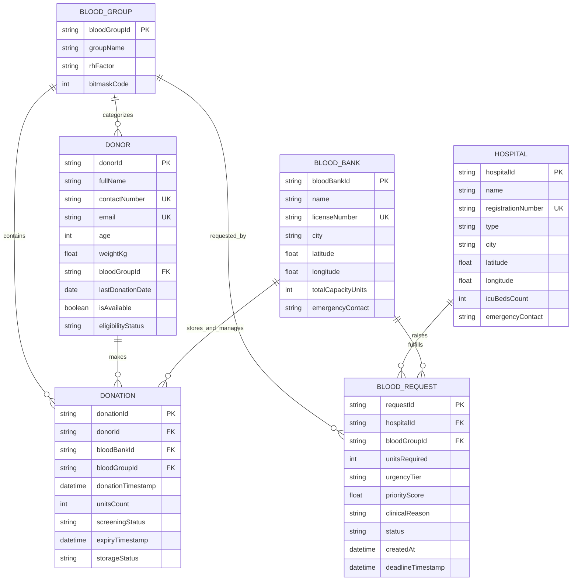
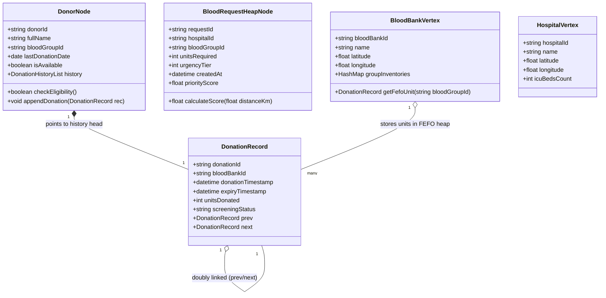

# Document 03: Core Entity Definitions & Schema Specifications

> **Scope:** Definitive technical specifications for the six core domain entities in **BloodLink**.  
> **Entities:** `Donor`, `Blood Group`, `Donation`, `Blood Bank`, `Hospital`, `Blood Request`.

---

## 1. Domain Entity Relationship Diagram (ERD)

---

## 2. In-Depth Entity Technical Specifications

### 2.1 Entity: `Donor`
Represents an individual who voluntarily registers to donate blood.

* **Domain Invariants & Validation Rules:**
  * Age must satisfy $18 \le \text{age} \le 65$.
  * Minimum weight requirement: $\ge 45\text{ kg}$ (to prevent post-donation syncope).
  * Minimum cooldown window: $\ge 90\text{ days}$ between whole blood donations.
  * Contact and Email must be uniquely indexed.
* **In-Memory DS Representation:** `DonorNode` stored in `DonorRegistryMap` (Hash Map) with an embedded pointer to `DonationHistoryList` (Doubly Linked List).

#### Attributes Specification Table:
| Field Name | Data Type | Nullable | Description / Invariants |
| :--- | :--- | :---: | :--- |
| `donorId` | `VARCHAR(36)` | No | Primary Key (UUIDv4). Unique donor identifier. |
| `fullName` | `VARCHAR(100)` | No | Legal name of donor. |
| `dateOfBirth` | `DATE` | No | Used to dynamically compute age ($\ge 18$ and $\le 65$). |
| `gender` | `ENUM('M','F','Other')` | No | Biological gender for cooldown and physiological thresholds. |
| `bloodGroupId` | `VARCHAR(10)` | No | Foreign Key referencing `Blood Group`. |
| `contactNumber`| `VARCHAR(15)` | No | E.164 phone format; Unique index for fast mobile OTP/login. |
| `email` | `VARCHAR(120)` | No | RFC 5322 compliant; Unique index. |
| `city` | `VARCHAR(60)` | No | City of residence for regional clustering. |
| `latitude` | `DECIMAL(10,7)` | Yes | Coordinates for spatial proximity routing. |
| `longitude`| `DECIMAL(10,7)` | Yes | Coordinates for spatial proximity routing. |
| `weightKg` | `DECIMAL(5,2)` | No | Minimum $45.00\text{ kg}$. |
| `lastDonationDate`| `DATE` | Yes | Date of last completed donation (cooldown baseline). |
| `isAvailable` | `BOOLEAN` | No | Donor opt-in toggle (Default: `TRUE`). |
| `eligibilityStatus`| `ENUM(...)` | No | `'ELIGIBLE'`, `'COOLDOWN'`, `'MEDICAL_DEFERRED'`, `'INACTIVE'`. |
| `donationCount`| `INT UNSIGNED` | No | Lifetime completed donation tally (Default: `0`). |
| `historyHead` | `Pointer` | Yes | Pointer to head of `DonationHistoryList` (In-Memory only). |

---

### 2.2 Entity: `Blood Group`
Represents the standard immunological classification of human blood based on ABO antigens and Rhesus (Rh) factor.

* **Domain Invariants:**
  * Fixed, immutable set of 8 standard groups: `A+`, `A-`, `B+`, `B-`, `AB+`, `AB-`, `O+`, `O-`.
  * Pre-calculated compatibility bitmasks for $O(1)$ constant-time compatibility tests.
* **In-Memory DS Representation:** `BloodGroupCatalog` (Static Array / Enum with Bitwise LUT).

#### Attributes Specification Table:
| Field Name | Data Type | Nullable | Description / Invariants |
| :--- | :--- | :---: | :--- |
| `bloodGroupId` | `VARCHAR(10)` | No | Primary Key (e.g., `'O_POS'`, `'O_NEG'`, `'A_POS'`). |
| `groupName` | `VARCHAR(10)` | No | Display label (e.g., `'O+'`, `'AB-'`). |
| `rhFactor` | `ENUM('+','-')` | No | Rhesus factor. |
| `antigenType` | `ENUM('A','B','AB','NONE')` | No | ABO erythrocyte surface antigens. |
| `bitmaskCode` | `TINYINT UNSIGNED`| No | 8-bit integer mask for bitwise compatibility operations. |
| `compatibleDonorList`| `JSON / Array` | No | Array of bloodGroupIds that can safely donate to this group. |
| `compatibleRecipientList`| `JSON / Array`| No | Array of bloodGroupIds this group can safely donate to. |

---

### 2.3 Entity: `Donation`
Represents a single collection event where whole blood or components are harvested from a donor, tested, and cataloged into blood bank inventory.

* **Domain Invariants:**
  * Cannot be created if Donor cooldown period $< 90\text{ days}$.
  * Default volume is standard $1\text{ unit}$ ($\approx 350\text{--}450\text{ ml}$).
  * Expiry calculation: Whole blood expires in 35 days; Platelets in 5 days from collection timestamp.
  * Status transition: `COLLECTED` $\to$ `SCREENING` $\to$ (`APPROVED` / `REJECTED`) $\to$ `DISPATCHED` $\to$ `TRANSFUSED`.
* **In-Memory DS Representation:** `DonationRecord` node embedded in Donor's Doubly Linked List AND referenced inside Blood Bank's FEFO Min-Heap.

#### Attributes Specification Table:
| Field Name | Data Type | Nullable | Description / Invariants |
| :--- | :--- | :---: | :--- |
| `donationId` | `VARCHAR(36)` | No | Primary Key (UUIDv4) / Barcode identifier. |
| `donorId` | `VARCHAR(36)` | No | Foreign Key referencing `Donor`. |
| `bloodBankId` | `VARCHAR(36)` | No | Foreign Key referencing `Blood Bank` where unit is stored. |
| `bloodGroupId` | `VARCHAR(10)` | No | Foreign Key referencing `Blood Group`. |
| `donationTimestamp`| `DATETIME` | No | Exact timestamp of phlebotomy collection. |
| `unitsDonated` | `INT` | No | Standard unit count (Default: `1`). |
| `hemoglobinLevel` | `DECIMAL(4,2)`| No | Minimum $12.5\text{ g/dL}$ for safe collection. |
| `systolicBp` | `INT` | No | Healthy range: $100\text{--}140\text{ mmHg}$. |
| `diastolicBp` | `INT` | No | Healthy range: $60\text{--}90\text{ mmHg}$. |
| `screeningStatus` | `ENUM(...)` | No | `'PENDING'`, `'PASSED'`, `'FAILED'`, `'CONTAMINATED'`. |
| `expiryTimestamp` | `DATETIME` | No | Expiration date/time used as key in FEFO Min-Heap. |
| `storageStatus` | `ENUM(...)` | No | `'QUARANTINE'`, `'IN_STORAGE'`, `'RESERVED'`, `'DISPATCHED'`, `'EXPIRED'`. |

---

### 2.4 Entity: `Blood Bank`
Represents an authorized blood depository, storage bank, or regional processing center responsible for harvesting, testing, and storing blood bags.

* **Domain Invariants:**
  * Must hold a valid government medical license number.
  * Current stock units cannot exceed `totalCapacityUnits`.
* **In-Memory DS Representation:** Graph Vertex in the logistics network, containing internal separate Hash Map buckets pointing to FEFO Min-Heaps for each blood group.

#### Attributes Specification Table:
| Field Name | Data Type | Nullable | Description / Invariants |
| :--- | :--- | :---: | :--- |
| `bloodBankId` | `VARCHAR(36)` | No | Primary Key (UUIDv4). |
| `name` | `VARCHAR(150)`| No | Official registered name of blood bank facility. |
| `licenseNumber` | `VARCHAR(50)` | No | Unique medical regulatory license number. |
| `category` | `ENUM(...)` | No | `'GOVERNMENT'`, `'RED_CROSS'`, `'PRIVATE'`, `'HOSPITAL_ATTACHED'`. |
| `contactNumber` | `VARCHAR(15)` | No | Primary operational telephone. |
| `emergencyHotline`| `VARCHAR(15)`| No | 24/7 emergency dispatch contact line. |
| `city` | `VARCHAR(60)` | No | City location. |
| `pincode` | `VARCHAR(10)` | No | Postal code. |
| `latitude` | `DECIMAL(10,7)`| No | Spatial coordinate for distance matrix. |
| `longitude`| `DECIMAL(10,7)`| No | Spatial coordinate for distance matrix. |
| `totalCapacityUnits`| `INT` | No | Maximum safe storage volume. |
| `currentStockUnits`| `INT` | No | Current aggregate safe units in stock. |
| `hasComponentSeparator`| `BOOLEAN` | No | Capability to fractionate RBCs, plasma, platelets. |

---

### 2.5 Entity: `Hospital`
Represents a healthcare facility, trauma center, or surgical clinic that consumes blood inventory and originates emergency blood requests.

* **Domain Invariants:**
  * Must possess registered healthcare institution ID.
  * Maintains emergency admission capabilities and ambulance logistics coordinates.
* **In-Memory DS Representation:** Graph Vertex in the logistics network.

#### Attributes Specification Table:
| Field Name | Data Type | Nullable | Description / Invariants |
| :--- | :--- | :---: | :--- |
| `hospitalId` | `VARCHAR(36)` | No | Primary Key (UUIDv4). |
| `name` | `VARCHAR(150)`| No | Registered hospital name. |
| `registrationNumber`| `VARCHAR(50)`| No | Unique hospital accreditation number. |
| `type` | `ENUM(...)` | No | `'TRAUMA_LEVEL_1'`, `'GENERAL'`, `'SURGICAL'`, `'MATERNITY'`. |
| `city` | `VARCHAR(60)` | No | City location. |
| `address` | `TEXT` | No | Physical address for delivery dispatch. |
| `latitude` | `DECIMAL(10,7)`| No | Spatial coordinate for distance calculations. |
| `longitude`| `DECIMAL(10,7)`| No | Spatial coordinate for distance calculations. |
| `icuBedsCount`| `INT` | No | Indicator of emergency surgical intensity. |
| `emergencyPhone`| `VARCHAR(15)`| No | Immediate contact for triage confirmation. |

---

### 2.6 Entity: `Blood Request`
Represents a formal clinical requisition for blood units generated by a hospital or certified requester.

* **Domain Invariants:**
  * Urgency must be specified (`ROUTINE`, `URGENT`, `EMERGENCY`, `CRITICAL`).
  * If `EMERGENCY` or `CRITICAL`, routed to Binary Max-Heap; if `ROUTINE`, routed to FIFO Queue.
  * Priority score is dynamically maintained and updated as waiting time increases.
* **In-Memory DS Representation:** `HeapNode` in Emergency Max-Heap OR `QueueNode` in Routine FIFO Queue.

#### Attributes Specification Table:
| Field Name | Data Type | Nullable | Description / Invariants |
| :--- | :--- | :---: | :--- |
| `requestId` | `VARCHAR(36)` | No | Primary Key (UUIDv4). |
| `requesterId` | `VARCHAR(36)` | No | ID of user/requester creating the demand. |
| `hospitalId` | `VARCHAR(36)` | No | Foreign Key referencing recipient `Hospital`. |
| `patientName` | `VARCHAR(100)`| No | De-identified / anonymized patient name. |
| `patientAge` | `INT` | No | Age of recipient patient. |
| `bloodGroupId` | `VARCHAR(10)` | No | Foreign Key referencing required `Blood Group`. |
| `unitsRequired` | `INT` | No | Number of bags needed ($1 \le \text{units} \le 10$). |
| `urgencyTier` | `ENUM(...)` | No | `'ROUTINE'`, `'URGENT'`, `'EMERGENCY'`, `'CRITICAL'`. |
| `priorityScore` | `FLOAT` | No | Computed score driving Binary Max-Heap ranking. |
| `clinicalReason`| `VARCHAR(255)`| No | Clinical justification (e.g., "Cardiac surgery", "Post-trauma hemorrhage"). |
| `status` | `ENUM(...)` | No | `'PENDING'`, `'TRIAGED'`, `'ALLOCATED'`, `'DISPATCHED'`, `'FULFILLED'`, `'CANCELLED'`. |
| `createdAt` | `DATETIME` | No | Timestamp of initial requisition. |
| `deadlineTimestamp`| `DATETIME` | Yes | Target transfusion window. |
| `fulfilledAt` | `DATETIME` | Yes | Timestamp of fulfillment. |

---

## 3. Class Diagram: Data Structure & Memory Layout

