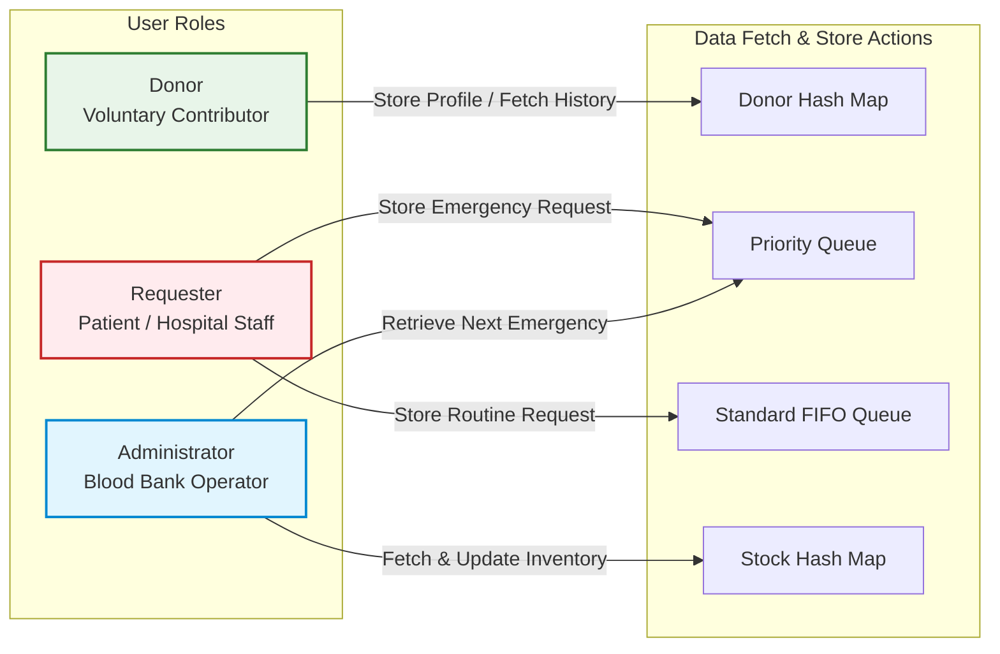
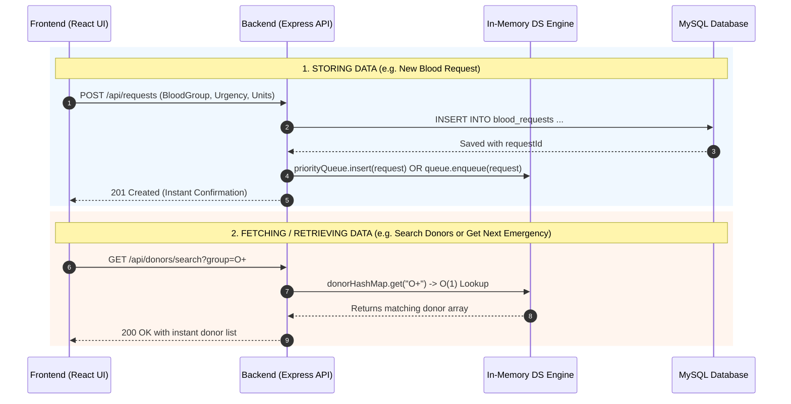
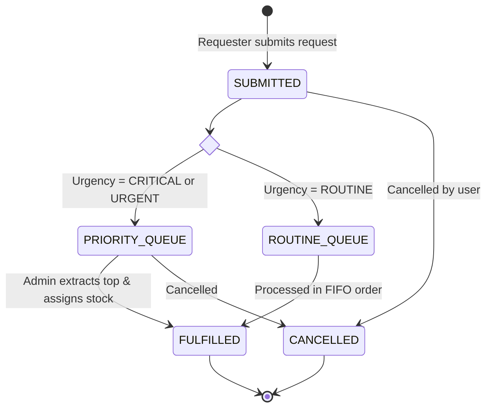
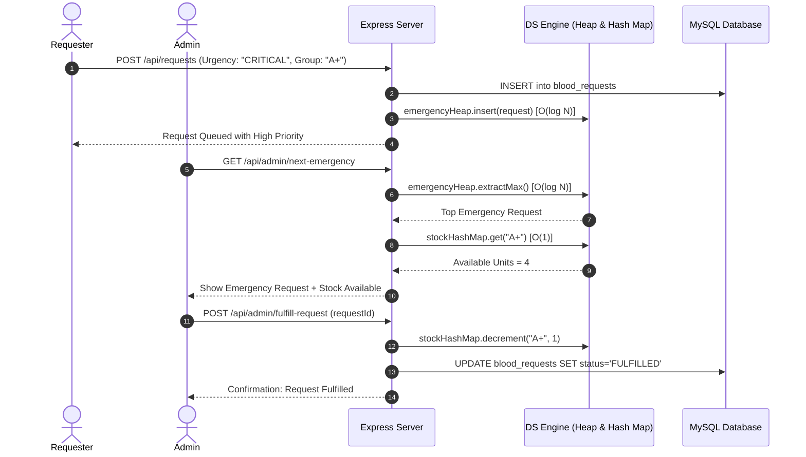
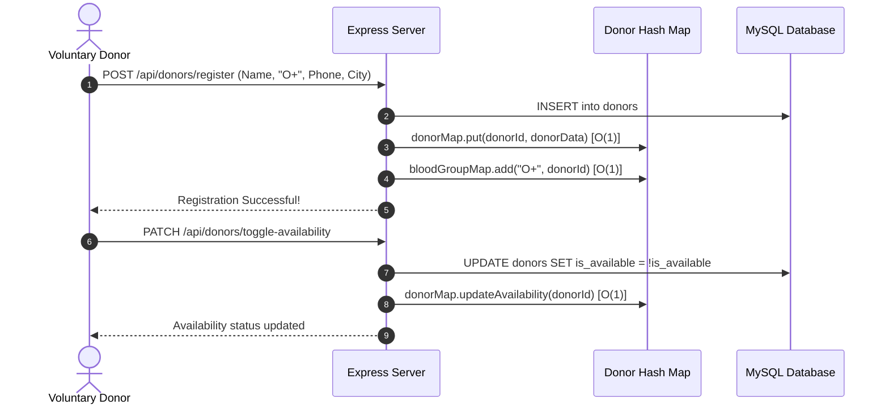

# Document 04: User Roles, RBAC & Simplified Workflows

> **Focus:** Clear, Pragmatic User Roles, Role-Based Access Control, and Fast-to-Build Operational Workflows with Seamless Data Storing, Fetching, and Retrieving.

---

## 1. User Roles & System Interaction

To keep implementation fast and straightforward, the system focuses on **three core roles** with intuitive, well-defined responsibilities:

### 1.1 Role: `Donor`
* **Purpose:** Individuals willing to donate blood.
* **Core Actions (Fast to Build):**
  * **Register / Store:** Submit registration form (name, blood group, contact, city, age, weight). Stored in MySQL and indexed in the **Donor Hash Map** ($O(1)$).
  * **Retrieve / Fetch:** View personal profile, donation eligibility status (automatically checks if last donation date was $\ge 90$ days ago), and past donation history.
  * **Update:** Simple one-click toggle to set availability (`Available` / `Unavailable`).

### 1.2 Role: `Requester`
* **Purpose:** Patients, family members, or doctors needing blood units.
* **Core Actions (Fast to Build):**
  * **Create / Store Request:** Fill a simple form with patient name, required blood group, hospital, units needed, and urgency level (`CRITICAL`, `URGENT`, `ROUTINE`).
    * **Critical / Urgent Requests:** Stored into the in-memory **Priority Queue (Max-Heap)** ($O(\log N)$).
    * **Routine Requests:** Stored into the in-memory **Standard Queue (FIFO)** ($O(1)$).
  * **Fetch / Retrieve Status:** Check the status of their request (`PENDING`, `MATCHED`, `FULFILLED`).
  * **Instant Donor Search:** Search available donors by blood group in $O(1)$ time via the **Donor Hash Map**.

### 1.3 Role: `Administrator`
* **Purpose:** Blood bank staff managing emergency allocation and stock.
* **Core Actions (Fast to Build):**
  * **Fetch Next Emergency:** Retrieve the most critical pending request from the **Priority Queue** with a single click (`extractMax()`).
  * **Fetch & Update Stock:** View blood unit counts per group from the **Stock Hash Map** ($O(1)$). Increment stock on new donation; decrement on fulfillment.
  * **Fulfill Requests:** Match the top emergency request with available stock, update MySQL status to `FULFILLED`, and sync the in-memory queue.

---

## 2. Role-Based Access Control (RBAC) Matrix

A simple, practical permissions structure that avoids complex role hierarchies:

| Feature / Data Entity | Donor | Requester | Administrator |
| :--- | :---: | :---: | :---: |
| **Register & Manage Own Profile** | ✅ Create / Read / Update | ❌ | ✅ Full Access |
| **Search Donors by Blood Group** | ❌ | ✅ Read ($O(1)$ Hash Map) | ✅ Read ($O(1)$ Hash Map) |
| **Create Blood Request** | ❌ | ✅ Create & View Own | ✅ Create & View All |
| **View Emergency Priority Queue** | ❌ | ❌ (Own status only) | ✅ Read & Extract Top ($O(\log N)$) |
| **View Routine Request Queue** | ❌ | ❌ (Own status only) | ✅ Read & Dequeue ($O(1)$) |
| **Update Blood Bank Inventory** | ❌ | ❌ | ✅ Add / Decrement Stock |
| **Record New Blood Donation** | ❌ | ❌ | ✅ Create & Update Cooldown |

---

## 3. Data Fetching, Storing, and Retrieving Architecture

To ensure fast development and reliable code, all entities follow a consistent **Dual-Layer Data Pipeline**:

### Explanation of the 3 Data Phases:
1. **Storing Data:**
   * Incoming data is validated in Express.
   * Saved permanently to MySQL to prevent data loss.
   * Inserted into the active in-memory Data Structure (Hash Map, Priority Queue, or FIFO Queue) for fast algorithmic access.
2. **Retrieving Data:**
   * Real-time read operations (search donors, check blood stock, pull highest emergency) query the **in-memory Data Structures** first.
   * This yields instant ($O(1)$ or $O(\log N)$) responses without heavy SQL queries.
3. **Startup Hydration:**
   * When the Node.js server starts, a simple `initDataStructures()` function runs:
     `SELECT * FROM donors` $\to$ populates `donorHashMap`.
     `SELECT * FROM blood_stock` $\to$ populates `stockHashMap`.
     `SELECT * FROM blood_requests WHERE status='PENDING'` $\to$ inserts into `priorityQueue` / `fifoQueue`.

---

## 4. Simplified Operational Workflows

### 4.1 Blood Request Lifecycle (Fast to Build)

---

### 4.2 Emergency Request & Triage Workflow (Sequence)

A streamlined 6-step flow that is easy to write in Node.js and easy to wire to a React button:

---

### 4.3 Donor Registration & Availability Workflow

