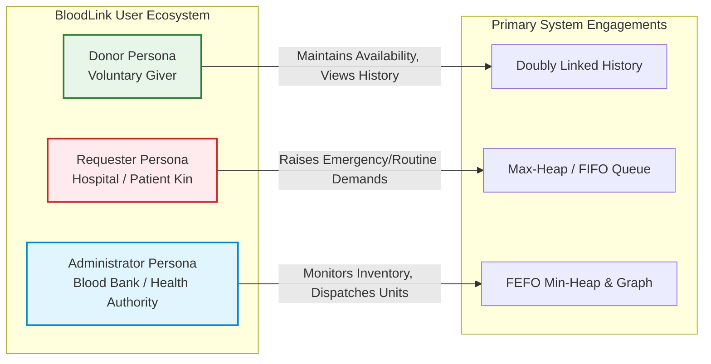
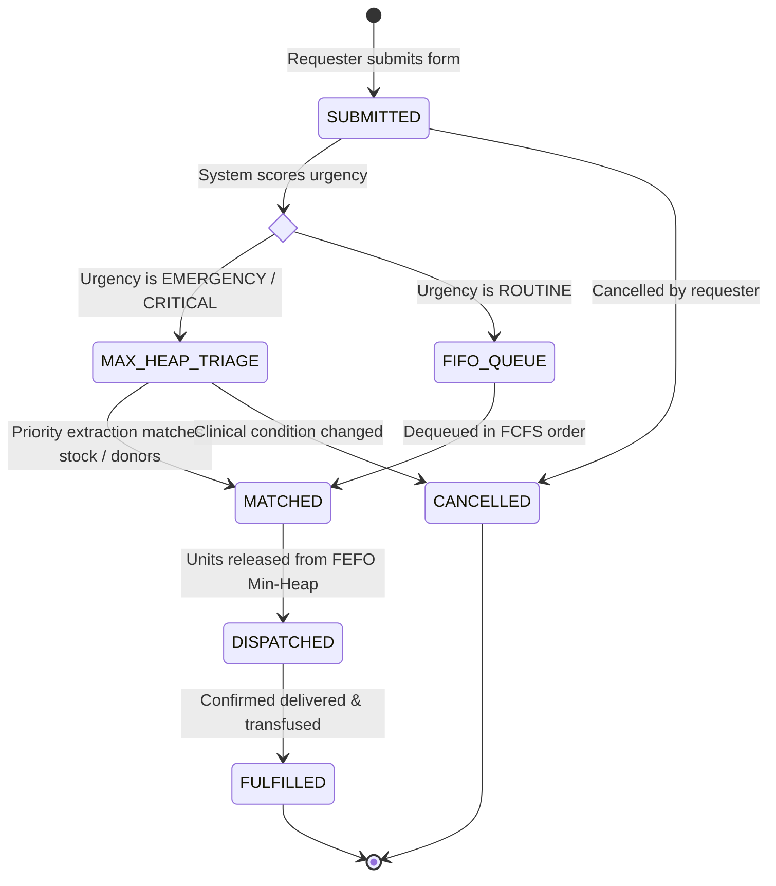
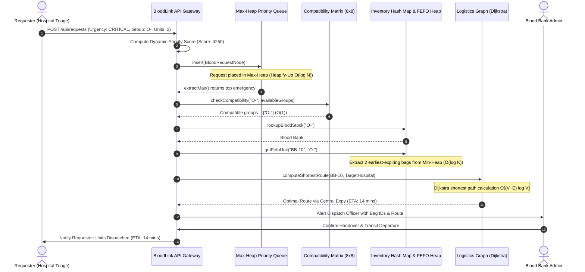
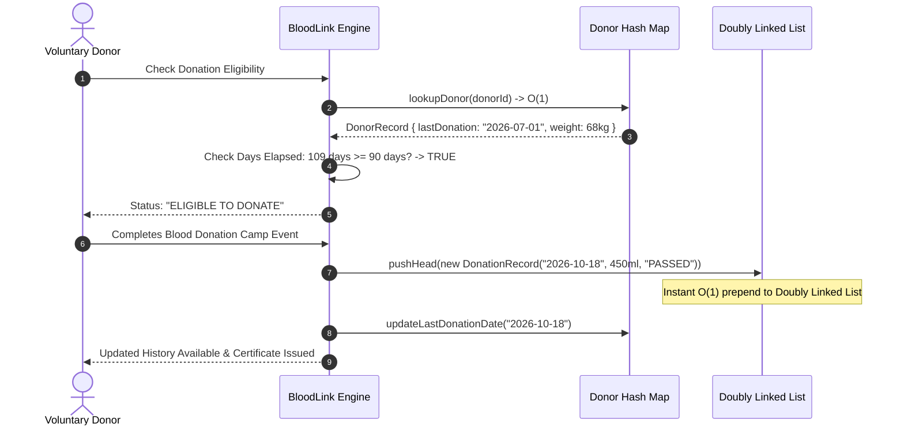

# Document 04: User Roles, RBAC & Algorithmic Workflows

> **Scope:** Definition of User Roles (`Donor`, `Requester`, `Administrator`), Access Control Policies, and End-to-End Operational Workflows in **BloodLink**.

---

## 1. User Roles & Personas

### 1.1 Role: `Donor`
* **Definition:** An individual who voluntarily participates in the blood supply network.
* **Core Responsibilities & Capabilities:**
  * Complete personal profile registration, contact credentials, and initial medical self-assessment.
  * Toggle availability status (`Available` vs `Temporarily Unavailable`).
  * Check algorithmic eligibility status in real-time (automatically evaluated against the 90-day cooldown window from their last recorded donation).
  * View their personal chronological donation timeline, retrieved by traversing their **Doubly Linked List** of `DonationRecord` nodes.
  * Receive emergency notifications when a matching critical blood request is within proximity.
  * Download an authenticated Donor ID Card and participation certificates.

### 1.2 Role: `Requester`
* **Definition:** An attending physician, hospital triage coordinator, or patient family member in immediate need of blood units.
* **Core Responsibilities & Capabilities:**
  * Raise an urgent or routine blood request specifying the required blood group, patient details, unit count, and hospital destination.
  * Select urgency classification (`Routine`, `Urgent`, `Emergency`, `Critical`).
  * Monitor request progress in real time as it moves through the **Binary Max-Heap Triage Engine** or **Circular FIFO Queue**.
  * View matched voluntary donors or assigned blood bank facilities.
  * Confirm unit arrival or cancel the request if medical circumstances change.

### 1.3 Role: `Administrator`
* **Definition:** Authorized blood bank supervisor, laboratory technician, or regional healthcare dispatch officer.
* **Core Responsibilities & Capabilities:**
  * Review and verify laboratory screening results (HIV, Hepatitis B/C, Syphilis, Malaria) for freshly harvested blood bags.
  * Approve tested blood units into active storage, automatically inserting them into the blood group's **FEFO Min-Heap** based on expiration date.
  * Monitor the active **Binary Max-Heap** priority queue to oversee critical triage allocations and prevent clinical starvation.
  * Initiate and oversee inter-facility blood transfers using the **Weighted Graph Logistics Engine** (Dijkstra shortest-route paths).
  * Supervise inventory levels, trigger low-stock camp drives, and audit expired blood bag disposals.

---

## 2. Role-Based Access Control (RBAC) Matrix

| System Resource / Entity | Donor Role | Requester Role | Administrator Role |
| :--- | :---: | :---: | :---: |
| **Donor Self Profile** | `CREATE`, `READ`, `UPDATE` | `READ` (Masked Contact) | `READ`, `UPDATE`, `DEACTIVATE` |
| **Donor Medical History (DLL)** | `READ` (Own History) | `NO_ACCESS` | `READ`, `AUDIT`, `APPEND` |
| **Blood Request Creation** | `NO_ACCESS` | `CREATE`, `READ` (Own), `CANCEL` | `CREATE`, `READ` (All), `CANCEL` |
| **Emergency Priority Queue (Max-Heap)** | `NO_ACCESS` | `READ` (Position / Status Only) | `READ`, `PEEK`, `EXTRACT`, `OVERRIDE` |
| **Routine Request Queue (FIFO)** | `NO_ACCESS` | `READ` (Position / Status Only) | `READ`, `DEQUEUE`, `MANAGE` |
| **Blood Bank Inventory (FEFO Heaps)** | `NO_ACCESS` | `READ` (Stock Count Only) | `CREATE`, `READ`, `DISPATCH`, `DISCARD` |
| **Logistics Routing (Graph)** | `NO_ACCESS` | `READ` (Delivery ETA) | `EXECUTE_ROUTING`, `MANAGE_NODES` |
| **Compatibility Matrix Inspection** | `READ` | `READ` | `READ`, `UPDATE_CONFIG` |

---

## 3. End-to-End Operational Workflows

### 3.1 Blood Request Lifecycle State Machine

---

### 3.2 Emergency Triage & Dispatch Sequence

---

### 3.3 Donor Eligibility & Donation History Workflow

