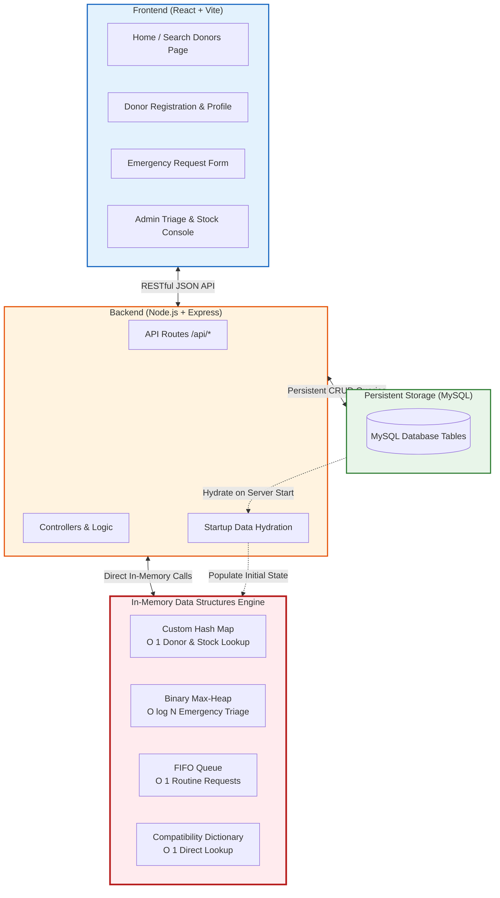

# Document 05: System Architecture & Simplified Folder Structure

> **Architecture Level:** 🟡 **Medium Mode (Recommended / Balanced Academic Baseline)**  
> **Focus:** Lightweight Full-Stack Architecture, In-Memory Data Synchronization, and Clean Project Directory Layout for Fast Development.

---

## 1. Simplified System Architecture



### The Startup Data Hydration Flow (Fast & Simple):
When the Node.js backend starts up, a single concise function initializes the in-memory structures:
```javascript
// src/services/dsEngine.js
async function initDSEngine(db) {
  // 1. Fetch active donors and store in Hash Map
  const [donors] = await db.query('SELECT * FROM donors WHERE is_available = true');
  donors.forEach(donor => {
    donorMap.put(donor.donorId, donor);
    bloodGroupMap.add(donor.bloodGroup, donor);
  });

  // 2. Fetch pending requests and insert into Heaps/Queues
  const [requests] = await db.query("SELECT * FROM blood_requests WHERE status = 'PENDING'");
  requests.forEach(req => {
    if (req.urgency === 'CRITICAL' || req.urgency === 'URGENT') {
      emergencyHeap.insert(req);
    } else {
      routineQueue.enqueue(req);
    }
  });

  // 3. Fetch stock counts into Stock Hash Map
  const [stocks] = await db.query('SELECT bloodGroup, COUNT(*) as count FROM donations WHERE status = "SAFE" GROUP BY bloodGroup');
  stocks.forEach(s => stockMap.put(s.bloodGroup, s.count));

  console.log('✅ In-Memory Data Structures successfully hydrated from MySQL.');
}
```

---

## 2. Clean, Minimal Repository Folder Structure

```
Assignment 1/
├── .gitignore                                # Git ignore file
├── flow.md                                   # Assignment roadmap
├── README.md                                 # Project overview & quickstart
│
├── docs/                                     # Stage 01 Specifications
│   ├── README.md                             # Documentation index
│   ├── 01_project_scope.md                   # Finalized scope & requirements
│   ├── 02_data_structures_architecture.md   # Hash Map, Priority Queue, Queue designs
│   ├── 03_entity_definitions.md              # 6 Core entity schemas
│   ├── 04_user_roles_and_workflows.md        # Workflows for Storing, Fetching, Retrieving
│   └── 05_system_architecture_and_folder_structure.md # Architecture & layout
│
├── src/                                      # Backend Code (Node.js + Express)
│   ├── config/
│   │   └── db.js                             # MySQL connection configuration
│   ├── core/
│   │   ├── data_structures/
│   │   │   ├── HashMap.js                    # Custom Separate-Chaining Hash Map
│   │   │   ├── PriorityQueue.js              # Binary Max-Heap for Emergency Triage
│   │   │   └── Queue.js                      # Standard FIFO Queue
│   │   └── compatibility.js                  # O(1) Blood Group Compatibility Dictionary
│   ├── controllers/
│   │   ├── donorController.js                # Donor register, search, toggle
│   │   ├── requestController.js              # Request submission, triage extraction
│   │   └── adminController.js                # Inventory stock & fulfillment
│   ├── routes/
│   │   ├── donorRoutes.js                    # /api/donors
│   │   ├── requestRoutes.js                  # /api/requests
│   │   └── adminRoutes.js                    # /api/admin
│   └── server.js                             # Express entry point & hydration
│
├── client/                                   # Frontend Code (React + Vite)
│   ├── public/
│   └── src/
│       ├── components/                       # Simple reusable UI components
│       ├── pages/
│       │   ├── HomePage.jsx                  # Hero & Donor Search
│       │   ├── DonorRegisterPage.jsx         # Donor Registration form
│       │   ├── RequestBloodPage.jsx          # Emergency / Routine Request form
│       │   └── AdminDashboard.jsx            # Emergency Queue & Stock view
│       ├── services/
│       │   └── api.js                        # Axios / Fetch API helpers
│       └── App.jsx
│
└── tests/                                    # Simple Test Scripts
    └── dsTests.js                            # Unit tests for HashMap, Heap, and Queue
```
