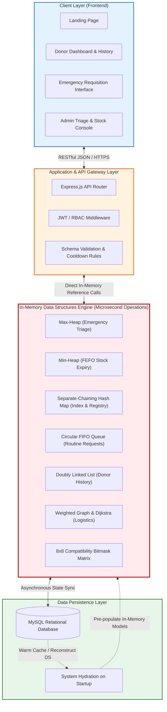

# Document 05: System Architecture & Repository Folder Structure

> **Scope:** Repository structure, multi-tiered architecture, in-memory DS engine integration, and Git repository guidelines for **BloodLink**.

---

## 1. Multi-Tiered System Architecture



### The In-Memory Hydration Pattern
1. **Server Initialization (`bootEngine()`):**
   - The application queries MySQL for active donors, current blood stock, and pending requests.
   - It instantiates custom Data Structures and populates them:
     - Donors are hashed into `DonorRegistryMap`.
     - Blood bags are inserted into their respective Blood Bank's `FEFO Min-Heap`.
     - Pending critical requests are inserted into the `Max-Heap Priority Queue`.
     - Routine requests enter the `Circular FIFO Queue`.
2. **Runtime Operations:**
   - All critical evaluations, triage sorting, donor searching, and compatibility verifications happen entirely inside the Data Structure Engine at memory speeds ($< 1\text{ ms}$).
3. **Persistence Sync:**
   - State mutations (e.g., successful unit dispatch, donor registration) are logged and persisted asynchronously into MySQL.

---

## 2. Repository Folder Structure

The project follows a clean separation of concerns, strictly isolating data structure implementations from web routing, database queries, and presentation components:

```
BloodLink/
├── .gitignore                                # Version control exclusion rules
├── flow.md                                   # Multi-stage assignment roadmap
├── README.md                                 # Top-level workspace overview
│
├── docs/                                     # Comprehensive Technical Specifications
│   ├── README.md                             # Documentation Index & Roadmap Matrix
│   ├── 01_project_scope.md                   # Scope, Objectives & Invariants
│   ├── 02_data_structures_architecture.md   # Heaps, Hash Maps, Queues & Graph Deep-Dive
│   ├── 03_entity_definitions.md              # 6 Core Entities & Relational Schemas
│   ├── 04_user_roles_and_workflows.md        # Roles, RBAC, State Machines & Sequences
│   └── 05_system_architecture_and_folder_structure.md # Codebase Structure & Topology
│
├── src/                                      # Backend & Core Engine Source Code
│   ├── config/                               # System configuration & environment loaders
│   │   ├── database.js                       # MySQL connection pool configuration
│   │   └── constants.js                      # Urgency weights, cooldown periods, thresholds
│   │
│   ├── core/                                 # Data Structures & Pure Algorithmic Engine
│   │   ├── data_structures/                  # Handcrafted Custom Data Structures
│   │   │   ├── HashMap.js                    # Custom Separate-Chaining Hash Map
│   │   │   ├── MaxHeap.js                    # Binary Max-Heap for Emergency Triage
│   │   │   ├── MinHeap.js                    # Binary Min-Heap for FEFO Expiration
│   │   │   ├── CircularQueue.js              # Circular FIFO Queue for Routine Requests
│   │   │   ├── DoublyLinkedList.js           # Doubly Linked List for Donation History
│   │   │   ├── Graph.js                      # Adjacency List Graph for Logistics
│   │   │   └── CompatibilityMatrix.js        # 8x8 Blood Group Compatibility Matrix
│   │   └── algorithms/                       # Domain Algorithms
│   │       ├── triageScorer.js               # Priority evaluation calculation
│   │       ├── dijkstraRouter.js             # Shortest delivery corridor calculation
│   │       └── eligibilityChecker.js         # 90-day cooldown & health validation
│   │
│   ├── models/                               # Data Models & Schemas
│   │   ├── Donor.js                          # Donor entity schema & validation
│   │   ├── BloodGroup.js                     # Blood Group static catalog
│   │   ├── Donation.js                       # Donation entity schema
│   │   ├── BloodBank.js                      # Blood Bank entity schema
│   │   ├── Hospital.js                       # Hospital entity schema
│   │   └── BloodRequest.js                   # Blood Request entity schema
│   │
│   ├── controllers/                          # Request Handlers & API Controllers
│   │   ├── donorController.js                # Donor registration, search, eligibility
│   │   ├── requestController.js              # Emergency triage & routine requisition
│   │   ├── inventoryController.js            # Stock tracking & FEFO allocations
│   │   ├── hospitalController.js             # Hospital management
│   │   └── adminController.js                # Queue inspection, dispatch & analytics
│   │
│   ├── routes/                               # Express REST API Route Declarations
│   │   ├── donorRoutes.js                    # /api/donors/*
│   │   ├── requestRoutes.js                  # /api/requests/*
│   │   ├── inventoryRoutes.js                # /api/inventory/*
│   │   └── adminRoutes.js                    # /api/admin/*
│   │
│   ├── services/                             # Business Logic & Orchestration
│   │   ├── engineService.js                  # DS In-Memory Engine orchestrator
│   │   ├── triageService.js                  # Max-Heap ingestion & queue management
│   │   └── logisticsService.js               # Inter-facility routing coordinator
│   │
│   └── utils/                                # Helpers, loggers, formatters
│       ├── logger.js                         # Structured logging
│       └── validator.js                      # Input sanitization
│
├── client/                                   # Frontend Application (React + Vite)
│   ├── public/                               # Static assets and icons
│   └── src/
│       ├── assets/                           # SVG icons, imagery
│       ├── components/                       # Modular reusable UI widgets
│       │   ├── common/                       # Buttons, Cards, Modals, Badges
│       │   ├── triage/                       # Real-time Heap Visualizer widget
│       │   └── donor/                        # Eligibility gauge & donation timeline
│       ├── pages/                            # Top-level view pages
│       │   ├── LandingPage.jsx               # Hero, search & call to action
│       │   ├── DonorDashboard.jsx            # Donor profile & DLL timeline
│       │   ├── EmergencyRequestPage.jsx      # High-urgency request submission
│       │   └── AdminDashboard.jsx            # Queue monitoring & inventory console
│       ├── hooks/                            # Custom React hooks
│       └── services/                         # Client API communication services
│
└── tests/                                    # Automated Test Suite
    ├── data_structures/                      # Unit tests for custom DS implementations
    │   ├── HashMap.test.js                   # Collision handling, resize, O(1) checks
    │   ├── MaxHeap.test.js                   # Heapify-up/down, priority order checks
    │   ├── MinHeap.test.js                   # FEFO earliest expiration order checks
    │   ├── CircularQueue.test.js             # Wrap-around and capacity checks
    │   └── DoublyLinkedList.test.js          # Bidirectional traversal & node excision
    └── integration/                          # End-to-end API & triage engine tests
        └── emergencyTriage.test.js           # Multi-request arrival and allocation test
```

---

## 3. Git Repository Architecture & Branching Strategy

The repository is initialized with a Git version control system following standard git flow practices:

* **`main`**: Production-ready, fully tested releases. Contains stable milestone submissions.
* **`develop`**: Integration branch for completed stage deliverables.
* **`feature/<stage-name>`**: Topic branches for individual assignments (e.g., `feature/stage-01-requirements`, `feature/stage-02-database-design`, `feature/stage-05-custom-ds`).

### Standard Commit Message Convention
```text
<type>(<scope>): <short summary>

[optional body describing technical rationale and DS implications]

Types:
- feat: New feature or DS implementation
- docs: Documentation and architectural blueprints
- refactor: Algorithmic optimization without changing behavior
- test: Unit tests for custom data structures
- chore: Tooling, package management, config
```
