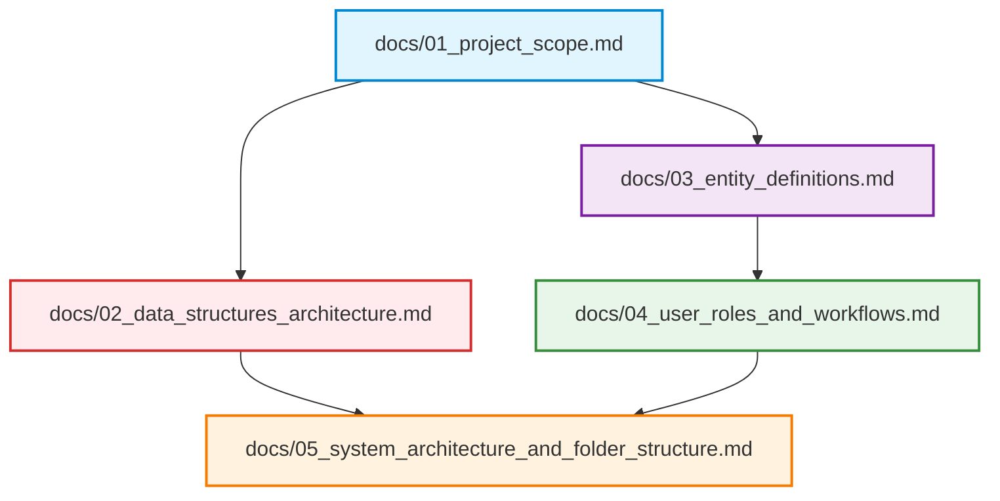

# BloodLink: Data Structure-Driven Blood Donor & Emergency Management System

> **Academic Coursework / Engineering Specification: Stage 01 — Project Foundation & Requirements**  
> *Target Domain*: Algorithmic Blood Supply Chain, Real-time Emergency Triage, and Donor Management.

---

## 📌 Document Overview

This directory contains the foundational specifications, algorithmic blueprints, entity schemas, role-based workflows, and repository blueprints for **BloodLink**. 

Unlike conventional web management systems that rely strictly on sequential database queries, **BloodLink is designed from first principles around core Computer Science Data Structures**. High-urgency hospital requests and life-saving donor matching demand predictable, microsecond-level algorithmic time complexities ($O(1)$ lookup, $O(\log N)$ priority scheduling).

---

## 📂 Documentation Index

| File | Document Title | Primary Focus & Highlights |
| :--- | :--- | :--- |
| **[01_project_scope.md](file:///a:/Nirma/DS/Assignment%201/docs/01_project_scope.md)** | **Project Scope & Requirements** | Problem statement, primary objectives, functional & non-functional requirements, in-scope vs. out-of-scope boundaries. |
| **[02_data_structures_architecture.md](file:///a:/Nirma/DS/Assignment%201/docs/02_data_structures_architecture.md)** | **Data Structures Flow & Architecture** | **The Core Foundation**: Custom Hash Maps, Binary Max-Heap (Emergency Triage), Binary Min-Heap (FEFO Inventory Expiry), FIFO Queues, Doubly Linked Lists, Weighted City Graphs, and Complexity Tables. |
| **[03_entity_definitions.md](file:///a:/Nirma/DS/Assignment%201/docs/03_entity_definitions.md)** | **Core Entity Definitions** | Technical specifications for the 6 core entities: `Donor`, `Blood Group`, `Donation`, `Blood Bank`, `Hospital`, and `Blood Request`. Includes Mermaid Class & ER diagrams. |
| **[04_user_roles_and_workflows.md](file:///a:/Nirma/DS/Assignment%201/docs/04_user_roles_and_workflows.md)** | **User Roles, RBAC & Workflows** | Deep dive into `Donor`, `Requester`, and `Administrator` roles; Role-Based Access Control (RBAC) matrix; Request Lifecycle State Machine and Emergency Triage Sequence. |
| **[05_system_architecture_and_folder_structure.md](file:///a:/Nirma/DS/Assignment%201/docs/05_system_architecture_and_folder_structure.md)** | **Architecture & Repository Structure** | Full-stack architectural breakdown, in-memory DS engine separation, directory tree layout, and version control guidelines. |

---

## 🎯 Stage 01 Deliverables Checklist

- [x] **Finalize Project Scope**: Clear boundaries defined for emergency triage, inventory tracking, and donor dispatch.
- [x] **Core Entity Definitions**: Fully specified attributes, constraints, relationships, and DS mappings for the 6 required entities.
- [x] **Decide User Roles**: Detailed permissions, workflows, and journeys for Donors, Requesters, and Administrators.
- [x] **Data Structure Priority**: Engineered custom Hash Maps, Max-Heap, Min-Heap, FIFO Queue, Doubly Linked List, and Graph algorithms.
- [x] **Repository Structure & Git Setup**: Initialized Git repository with clean `.gitignore` and folder hierarchy.
