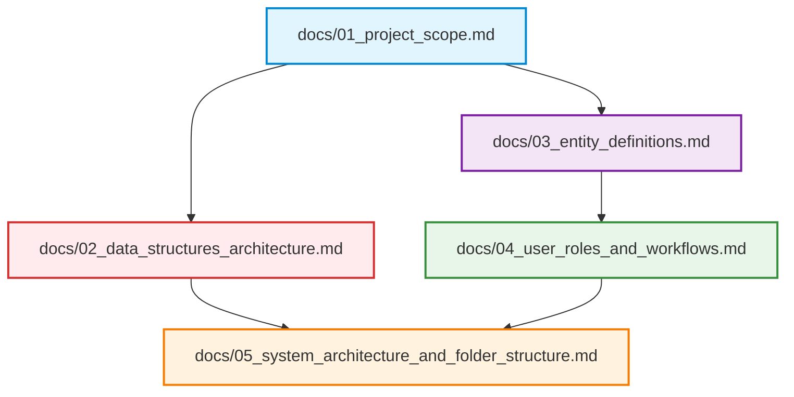

# BloodLink: DS-Based Blood Donor & Emergency Management System

> **Stage 01: Project Foundation & Requirements Specification**  
> **Philosophy:** High algorithmic value with practical, fast-to-build implementations centered on **Data Storing, Fetching, and Retrieving**.

---

## 📌 Document Overview

This directory contains the foundational specifications, algorithmic blueprints, entity schemas, and streamlined workflows for **BloodLink**.

The architecture prioritizes **three core Data Structures** that are easy to build in JavaScript while providing microsecond performance:
1. **Custom Hash Map:** Instant $O(1)$ donor lookup by blood group/ID and stock tracking.
2. **Priority Queue (Binary Max-Heap):** $O(\log N)$ prioritization of critical emergency blood requests.
3. **Standard FIFO Queue:** $O(1)$ fair first-come, first-served processing of routine requests.

---

## 📂 Documentation Index

| File | Document Title | Primary Focus & Highlights |
| :--- | :--- | :--- |
| **[01_project_scope.md](file:///a:/Nirma/DS/Assignment%201/docs/01_project_scope.md)** | **Project Scope & Requirements** | Problem statement, achievable boundaries, functional requirements for data storing, fetching, and retrieving. |
| **[02_data_structures_architecture.md](file:///a:/Nirma/DS/Assignment%201/docs/02_data_structures_architecture.md)** | **Data Structures Flow & Engine** | Streamlined custom Hash Map ($O(1)$), Binary Max-Heap ($O(\log N)$), FIFO Queue ($O(1)$), and Compatibility Dictionary with simple code contracts. |
| **[03_entity_definitions.md](file:///a:/Nirma/DS/Assignment%201/docs/03_entity_definitions.md)** | **Core Entity Definitions** | Technical specifications and schemas for `Donor`, `Blood Group`, `Donation`, `Blood Bank`, `Hospital`, and `Blood Request` with clean ERD and Class diagrams. |
| **[04_user_roles_and_workflows.md](file:///a:/Nirma/DS/Assignment%201/docs/04_user_roles_and_workflows.md)** | **User Roles, RBAC & Workflows** | Fast-to-build workflows for `Donor`, `Requester`, and `Administrator` detailing clear Data Storing, Fetching, and Retrieving sequences. |
| **[05_system_architecture_and_folder_structure.md](file:///a:/Nirma/DS/Assignment%201/docs/05_system_architecture_and_folder_structure.md)** | **Architecture & Codebase Layout** | Minimal full-stack design, startup in-memory data hydration, and clean folder tree. |

---

## 🎯 Stage 01 Deliverables Summary

- [x] **Streamlined Project Scope**: Practical boundaries focused on speed of development and high reliability.
- [x] **6 Core Entities Defined**: Minimal, clean fields optimized for easy MySQL storage and fast frontend rendering.
- [x] **User Roles & Clear Data Flow**: `Donor`, `Requester`, and `Administrator` workflows mapped to distinct Store, Fetch, and Retrieve operations.
- [x] **3 Core Data Structures**: Practical Hash Map, Priority Queue, and Queue designs.
- [x] **Clean Repository & Git Baseline**: Initialized Git repository and organized structure.
