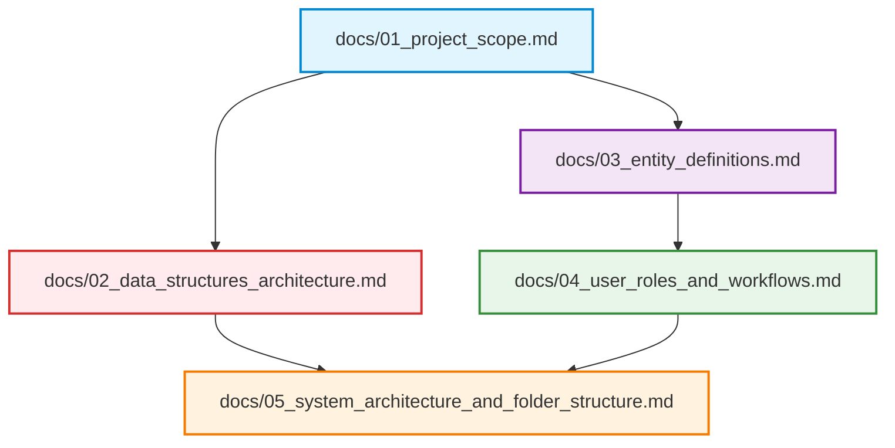

# BloodLink: DS-Based Blood Donor & Emergency Management System

> **Stage 01: Project Foundation & Requirements Specification**  
> **Selected Mode:** 🟡 **Medium Mode (Recommended / Balanced Academic Baseline)**  
> **Core Principle:** Custom Data Structures (Hash Map, Binary Max-Heap, Circular Queue) with genuine algorithmic rigor, high build feasibility, and seamless **Data Storing, Fetching, and Retrieving**.

---

## 📌 Architectural Mode Comparison

BloodLink is architected under **Medium Mode**, chosen specifically to balance high academic marks with rapid development feasibility:

| Feature | 🟢 Lower Mode | 🟡 Medium Mode (Selected) | 🔴 Higher Mode |
| :--- | :--- | :--- | :--- |
| **Donor Lookup & Stock** | JS Object / Array filter | **Custom Separate-Chaining Hash Map ($O(1)$)** | Custom Hash Map + Dynamic Rehashing |
| **Emergency Triage** | Array `sort()` | **Binary Max-Heap Priority Queue ($O(\log N)$)** | Dual Heaps + Complex Physics Scoring |
| **Routine Requests** | Array `push()` / `shift()` | **Circular FIFO Queue ($O(1)$)** | Multi-channel fair queue |
| **Compatibility Match** | Simple `if/else` | **Static 8-Blood Group Dictionary ($O(1)$)** | 8x8 Bitwise Bitmask Matrix |
| **Build Time** | 2 – 3 Hours | **4 – 6 Hours** | 12 – 16+ Hours |
| **Teacher Explanation** | Trivial (Low marks) | **Textbook Data Structures (Top marks)** | Overly complex to explain |

---

## 📂 Documentation Index

All Stage 01 specifications are organized inside the [`docs/`](file:///a:/Nirma/DS/Assignment%201/docs/README.md) directory:

| Document | Primary Focus & Highlights |
| :--- | :--- |
| **[`01_project_scope.md`](file:///a:/Nirma/DS/Assignment%201/docs/01_project_scope.md)** | **Project Scope & Requirements**: Problem statement, Medium Mode boundaries, functional requirements, and teacher viva defense strategy. |
| **[`02_data_structures_architecture.md`](file:///a:/Nirma/DS/Assignment%201/docs/02_data_structures_architecture.md)** | **Data Structures Flow & Engine**: Complete class blueprints for Custom Hash Map, Binary Max-Heap, Circular Queue, and Compatibility Map with index math, complexity tables, and viva Q&A. |
| **[`03_entity_definitions.md`](file:///a:/Nirma/DS/Assignment%201/docs/03_entity_definitions.md)** | **Core Entity Definitions**: Practical schemas for `Donor`, `Blood Group`, `Donation`, `Blood Bank`, `Hospital`, and `Blood Request` with clean ERD and Class diagrams. |
| **[`04_user_roles_and_workflows.md`](file:///a:/Nirma/DS/Assignment%201/docs/04_user_roles_and_workflows.md)** | **User Roles, RBAC & Workflows**: Practical workflows for `Donor`, `Requester`, and `Administrator` with detailed Store, Fetch, and Retrieve sequence diagrams. |
| **[`05_system_architecture_and_folder_structure.md`](file:///a:/Nirma/DS/Assignment%201/docs/05_system_architecture_and_folder_structure.md)** | **Architecture & Codebase Layout**: Full-stack design, startup in-memory data hydration, and clean folder tree. |

---

## 🎯 Stage 01 Deliverables Summary

- [x] **Medium Mode Finalized**: Clean balance of speed and algorithmic value.
- [x] **6 Core Entities Defined**: Minimal schemas ready for MySQL tables and React state.
- [x] **3 Core Data Structures Blueprint**: Custom Hash Map, Binary Max-Heap, Circular FIFO Queue with full code contracts.
- [x] **User Workflows Established**: Clear Store, Fetch, and Retrieve pipelines for Donors, Requesters, and Admins.
- [x] **Clean Repository & Git Baseline**: Initialized Git repository and organized structure.
